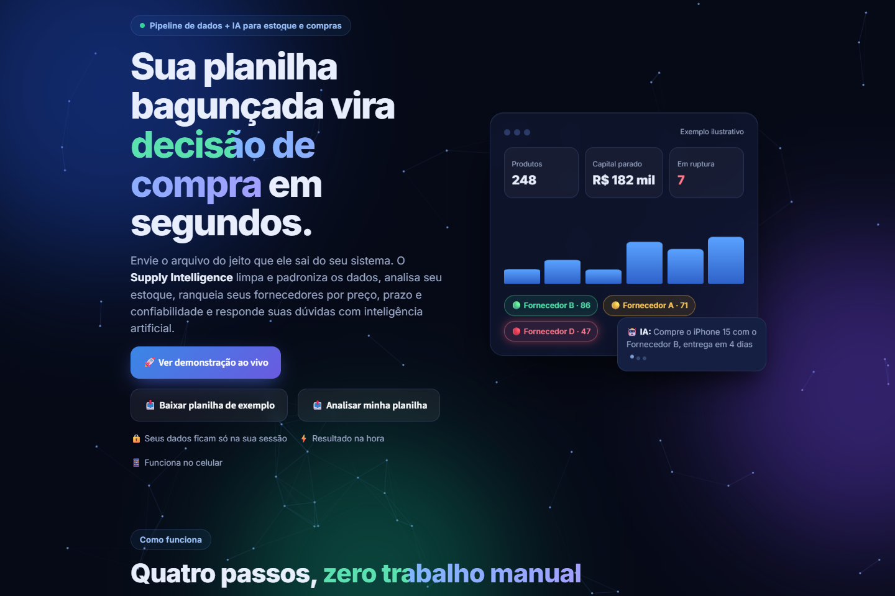
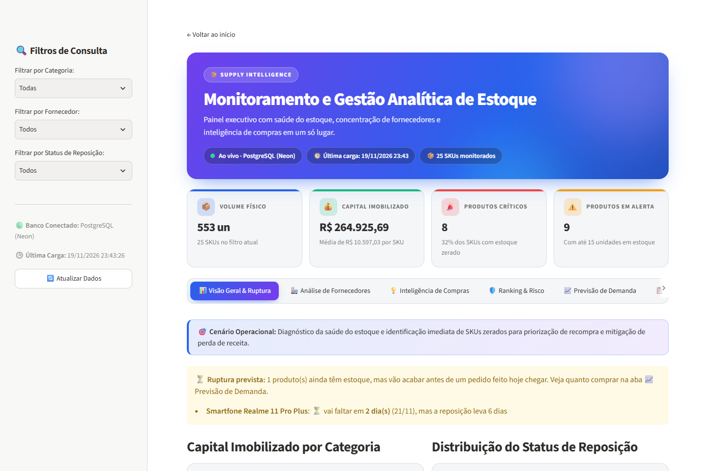
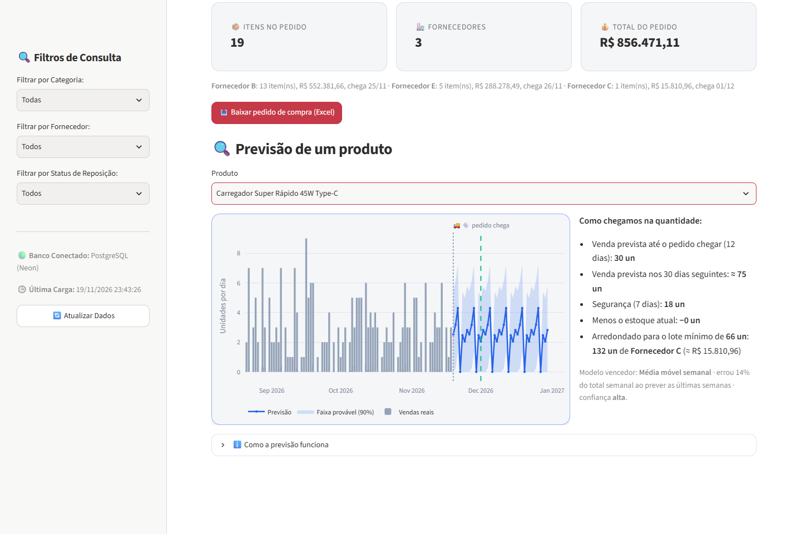
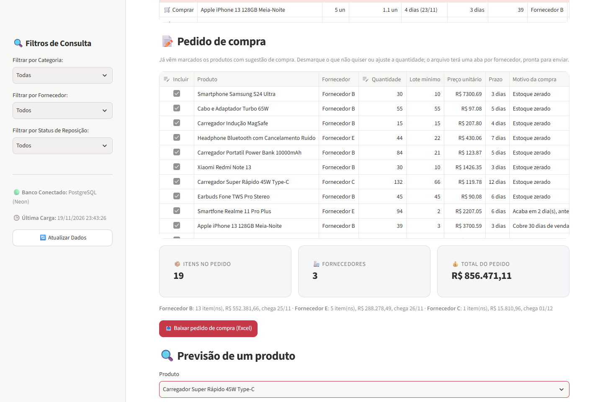
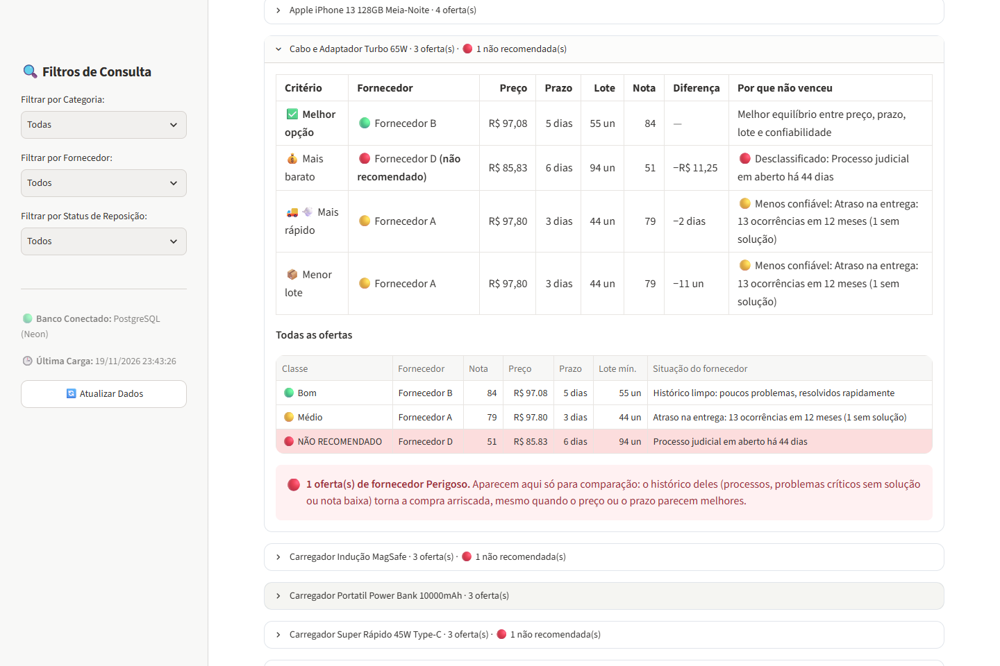
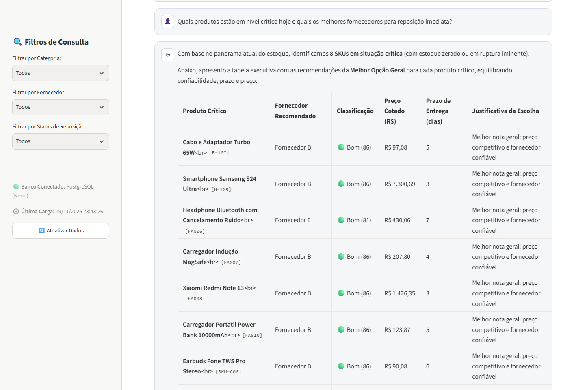

# 📦 Supply Intelligence

[Português](README.md) · **English**

[](https://estoque-dashboard-live.streamlit.app)


[](LICENSE)

**Your messy spreadsheet becomes a purchasing decision.** Upload the Excel or CSV file exactly as your store system exports it: Supply Intelligence cleans and standardizes the data, shows inventory health, ranks suppliers by price, lead time and reliability, forecasts demand for each product and builds a ready-to-send purchase order, with an AI assistant to answer questions.

> The app interface is in Brazilian Portuguese, built for small and mid-sized retailers in Brazil.

### 🚀 [Open the live demo](https://estoque-dashboard-live.streamlit.app)


---

## ✨ Highlights

| Feature | What it does |
| :--- | :--- |
| 🧹 **Automatic data cleaning** | Recognizes columns even with different names, converts messy prices, quantities and dates, merges different spellings of the same supplier and shows a report of every fix. |
| 🛡️ **Supplier ranking** | 0 to 100 score from price, lead time, minimum order quantity and incident history (delays, defects, lawsuits). Rates each supplier 🟢 Good, 🟡 Medium or 🔴 Dangerous and never recommends a 🔴 one. |
| 📈 **Demand forecasting** | Detects the store calendar (e.g. closed on Sundays, holidays) and runs a per-product competition between 4 models: Holt-Winters, Croston (SBA), weekly moving average and seasonal naive. The winner is chosen by weekly WAPE on held-out weeks, with a 90% prediction band and a confidence level. |
| 📝 **Purchase order** | Editable table and an Excel file with one sheet per supplier: quantity rounded to the minimum order, price, subtotal (as formulas), expected arrival date and the reason for each item. |
| 🤖 **AI assistant** | Google Gemini with a free Groq fallback, grounded on the dashboard data (inventory, supplier ranking, forecast) injected into the context on every question. |
| 🔒 **Privacy** | Uploaded data lives only in the browser session and disappears when the page is closed. Nothing is stored in the database. |

## 🖼️ Screenshots

| Landing page | Inventory overview |
| :---: | :---: |
|  |  |
| **Demand forecast** | **Purchase order** |
|  |  |
| **Suppliers: offers not recommended** | **AI assistant** |
|  |  |

## 🏗️ How it is built

```text
User spreadsheet ──▶ higienizacao/ ──┐            (browser session only)
                                      ├──▶ Streamlit dashboard (7 tabs) ◀──▶ Gemini → Groq fallback
ETL pipeline (demo) ──▶ Neon Postgres ┘          │
  (profiling, cleaning, star schema)             ├── regras_fornecedores.py (score and risk)
                                                 ├── previsao_demanda.py   (model competition)
                                                 └── pedido_compra.py      (Excel per supplier)
```

* **Data engineering:** Python and Pandas ETL pipeline with profiling, a canonical schema, a star schema on Neon PostgreSQL (SQLAlchemy, idempotent upserts, `CHECK` constraints) and an orchestrator with structured logging.
* **Isolated, tested business rules:** inventory, supplier, forecasting and purchase-order logic live in modules with no database access, covered by more than 200 `pytest` tests.
* **Resilient AI:** cascade of Gemini models with timeouts, Groq fallback with a compact context, per-session question limit and error messages that never expose data.
* **Interface:** Streamlit with custom CSS, light/dark theme, mobile layout and Plotly charts.

## 📚 Documentation (in Portuguese)

* [🏗️ Architecture and data engineering](docs/arquitetura.md)
* [🧹 Spreadsheet upload and cleaning](docs/higienizacao.md)
* [🛡️ Suppliers and AI assistant](docs/fornecedores-e-ia.md)
* [🔮 Demand forecasting and purchase order](docs/previsao-de-demanda.md)
* [🚀 Running locally](docs/como-executar.md)

## ⚡ Run locally

```bash
git clone https://github.com/paulocid95/pipeline-de-engenharia-e-analise-de-estoque.git
cd pipeline-de-engenharia-e-analise-de-estoque
python -m venv .venv && source .venv/bin/activate   # Windows: .venv\Scripts\Activate.ps1
pip install -r requirements.txt
streamlit run app.py
```

The demo reads its data from PostgreSQL and the assistant uses AI API keys, both set in `.streamlit/secrets.toml` (template in `.streamlit/secrets.toml.example`). See the [full guide](docs/como-executar.md) for creating and loading the database with the pipeline.

## 👨‍💻 Author

Built by **Paulo Cid** · Data Engineering and Analytics with Python, PostgreSQL and Streamlit · GitHub: [@paulocid95](https://github.com/paulocid95)

[MIT](LICENSE) license.
