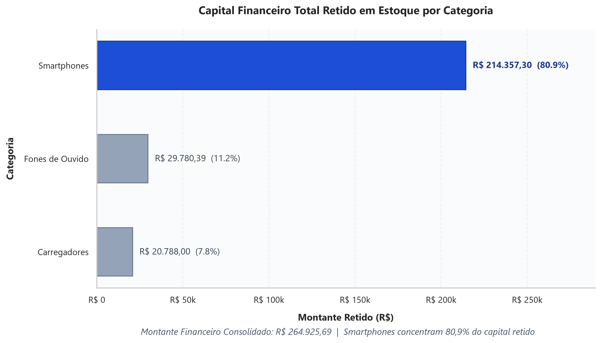
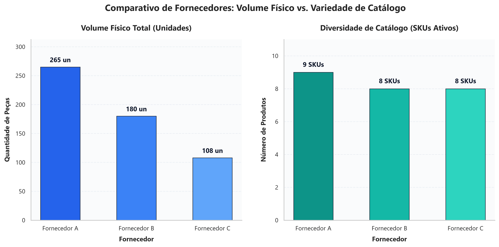
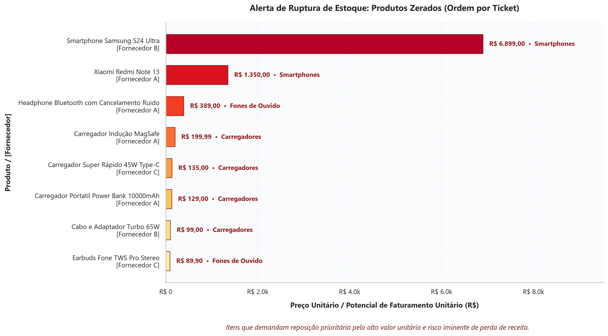

# 📦 Supply Intelligence: Engenharia de Dados, Análise de Estoque & Assistente de IA

[](https://estoque-dashboard-live.streamlit.app)

> 🚀 **Dashboard em Produção:** Acesse a aplicação interativa em tempo real: [estoque-dashboard-live.streamlit.app](https://estoque-dashboard-live.streamlit.app)


Solução modular e automatizada de **Engenharia e Análise de Dados** ponta a ponta desenvolvida em **Python** e **Pandas**, com persistência relacional no **Neon PostgreSQL (Cloud)** com **SQLAlchemy**, orquestração completa do pipeline de ETL, geração de relatórios executivos e disponibilização de um dashboard interativo em tempo real hospedado no **Streamlit Community Cloud**. A plataforma conta agora com um **Assistente Virtual de Suprimentos e Compras com IA Generativa (Google Gemini)** integrado diretamente à base em tempo real, permitindo aos gestores consultar diagnósticos operacionais, recomendações multicritério de cotações de fornecedores e planos de mitigação de rupturas de estoque com streaming nativo e zero alucinação. O sistema realiza data profiling, higienização, mapeamento para schema canônico, carga em **Star Schema**, cálculo de indicadores financeiros e auditoria preditiva a partir de fontes de múltiplos fornecedores.


---


## 🎯 Problema de Negócio


Em ambientes de varejo e comércio eletrônico com múltiplos parceiros de abastecimento, a centralização dos dados de estoque enfrenta obstáculos críticos devido à **heterogeneidade e falta de governança na origem dos arquivos**.


Neste projeto, três fornecedores distintos (**Fornecedor A, Fornecedor B e Fornecedor C**) fornecem diariamente os seus catálogos de produtos com graves problemas de qualidade de dados:


* **Formatos e Schemas Distintos:** Nomes de colunas despadronizados para representar as mesmas entidades (por exemplo: `id_produto` vs `codigo_item` vs `sku`; `preco_unitario` vs `Preco` vs `valor_brl`; `qtd_estoque` vs `Quantidade` vs `estoque_disponivel`).

* **Erros de Digitação e Variações Textuais:** Nomes de produtos e departamentos escritos com erros de digitação e caixas variadas (`"Smartfone"`, `"smarthphone"`, `"FONE DE OUVIDO"`, `"audio / fone ouvido"`, `"Indussão"`, `"bluetoth"`).

* **Divergências de Moeda e Tipos Corrompidos:** Preços inseridos como texto com símbolo de moeda (`"R$ 4.299,00"`), separadores de milhar com ponto e decimais com vírgula, strings com instruções não numéricas (`"consultar"`) e quantidades acompanhadas de texto (`"15 un"`, `"30.0"`).

* **Registros Nulos e Valores Inválidos:** Itens com preços ausentes ou zerados (`0,00`), campos de categoria vazios (`NaN`) e quantidades em estoque negativas (`-3`, `-10`, `-1`) ou registradas como `"SEM ESTOQUE"`.


**Objetivo:** Construir um pipeline resiliente e auditável em Python que converta arquivos heterogêneos e inconsistentes em uma base única e fidedigna (Single Source of Truth), alimente um banco relacional em nuvem (PostgreSQL / Neon) sob modelagem dimensional e disponibilize camadas visuais de consumo analítico para suporte à decisão.


---


## 🏗️ Estrutura de Pastas e Arquitetura


O pipeline segue um fluxo lógico desacoplado e modular com arquitetura ponta a ponta conectada à nuvem:

```text
[dados_brutos/] (Fontes Despadronizadas)
       │
       ▼
[exploracao_diagnostico.py] (Profiling: dtypes, nulos, cabeçalhos)
       │
       ▼
[limpeza_padronizacao.py] (ETL: Schema Canônico, Regex, Coerção, Dedução)
       │
       ▼
[dados_processados/estoque_consolidado_limpo.csv] (Base Canônica SSOT)
       │
       ├──▶ [analise_negocio.py] ──▶ [dados_processados/resumo_kpis_categoria.csv]
       │
       ├──▶ [visualizacao_graficos.py] ──▶ [graficos/*.png] (Gráficos Executivos 300 DPI)
       │
       └──▶ [carregar_dados.py] ──▶ [Neon PostgreSQL (Cloud)]
                                            │
                                            ▼ (SQLAlchemy / Context Injection)
                                  [Streamlit Community Cloud] ◀──▶ [Google Gemini API]
                                  (estoque-dashboard-live.streamlit.app)   (GenAI / SDK google-genai)
```

### 🛠️ Tecnologias Utilizadas e Nuvem

| Camada | Tecnologia | Finalidade no Projeto |
| :--- | :--- | :--- |
| **Linguagem & Manipulação** | Python 3.10+, Pandas | Engenharia de dados, profiling exploratório, pipeline de ETL e cálculo de KPIs |
| **Banco de Dados (Cloud)** | **Neon PostgreSQL (Cloud)** | Data Warehouse relacional serverless em nuvem com modelagem dimensional (*Star Schema*) |
| **Conectividade & ORM** | SQLAlchemy, psycopg2-binary | Gerenciamento de engine, pool de conexões e execução transacional segura |
| **Inteligência Artificial (GenAI)** | **Google Gemini (3.8 Flash)**, `google-genai` | Assistente virtual de suprimentos, recomendação multicritério de compras e resiliência em cascata |
| **Dashboard & Visualização Interativa** | Streamlit, Plotly Express | Aplicação analítica com filtros dinâmicos, métricas executivas, 5 abas e gráficos interativos |
| **Deploy & Hospedagem em Nuvem** | **Streamlit Community Cloud** | Hospedagem contínua, CI/CD integrado ao GitHub e disponibilização pública da aplicação |
| **Visualização Executiva** | Matplotlib, Seaborn | Geração de gráficos estáticos em alta resolução (300 DPI) para relatórios |
| **Configuração & Controle de Versão** | python-dotenv, Git, GitHub | Gestão segura de variáveis de ambiente (`.env`, `secrets.toml`) e controle de versão |

### Estrutura do Diretório do Projeto:

```text
pipeline-analise-estoque-python/
│
├── .streamlit/                            # Configurações do Streamlit e credenciais
│   ├── secrets.toml.example               # Modelo de credenciais e segredos (GEMINI_API_KEY, DATABASE_URL)
│   └── secrets.toml                       # Segredos locais ativos (ignorado pelo Git)
│
├── dados_brutos/                          # Arquivos CSV brutos enviados pelos fornecedores
│   ├── fornecedor_a.csv
│   ├── fornecedor_b.csv
│   └── fornecedor_c.csv
│
├── dados_processados/                     # Dados tratados e resumos analíticos exportados
│   ├── estoque_consolidado_limpo.csv
│   └── resumo_kpis_categoria.csv
│
├── graficos/                              # Gráficos executivos gerados em alta resolução
│   ├── valor_por_categoria.png
│   ├── distribuicao_estoque_fornecedor.png
│   └── alerta_ruptura_estoque.png
│
├── gerar_dados_brutos.py                  # Script de simulação de dados e inconsistências
├── exploracao_diagnostico.py              # Script de diagnóstico exploratório e profiling
├── limpeza_padronizacao.py                # Pipeline de higienização, mapeamento e consolidação
├── analise_negocio.py                     # Cálculo de KPIs financeiros e detecção de rupturas
├── visualizacao_graficos.py               # Visualização e renderização gráfica executiva
│
├── criar_tabelas.py                       # DDL: Provisionamento de schemas, tabelas e constraints SQL
├── criar_tabela_cotacoes.py               # DDL: Tabela fato de cotações concorrentes (core.fato_cotacoes)
├── gerar_cotacoes_fornecedores.py         # Simulação e carga de matriz concorrente de cotações
├── carregar_dados.py                      # Ingestão dimensional com Upsert no Neon PostgreSQL
├── consultar_banco.py                     # Auditoria pós-carga e consultas SQL analíticas
├── pipeline_completo.py                   # Orquestrador mestre automatizado de ponta a ponta
│
├── assistente_estoque.py                  # Módulo de IA: Chatbot e inteligência de compras com Google Gemini
├── app.py                                 # Painel analítico interativo com 5 abas via Streamlit
│
├── requirements.txt                       # Dependências do ambiente Python (inclui google-genai)
├── .env                                   # Variáveis de ambiente e credenciais (DATABASE_URL, GEMINI_API_KEY)
├── .gitignore                             # Regras de exclusão do Git
└── README.md                              # Documentação principal do projeto
```


---


## ⚙️ Decisões de Engenharia de Dados


1. **Padronização para Schema Canônico:**

   * Mapeamento explícito das colunas heterogêneas para o padrão unificado: `id_produto`, `produto`, `categoria`, `preco`, `estoque`, `fornecedor`.

   * Preservação da rastreabilidade da origem através da injeção do metadado de fornecedor.


2. **Coerção Numérica e Limpeza de Preços:**

   * Utilização de expressões regulares para remoção do prefixo monetário `R$` e de separadores de milhar no padrão brasileiro (`.` antecedendo 3 dígitos).

   * Substituição da vírgula decimal pelo ponto flutuante padrão do Python.

   * Aplicação de `pd.to_numeric(..., errors='coerce')` para converter textos (ex.: `"consultar"`) em `NaN`.

   * **Auditoria de Descarte:** Registros com preços nulos ou `<= 0` (como itens em revisão a `0,00`) foram removidos com log detalhado, uma vez que preços financeiros não devem ser inventados sem regras de negócio acordadas.


3. **Tratamento de Estoques e Valores Negativos:**

   * Limpeza de sufixos de texto (ex.: `"15 un"`) e mapeamento de valores como `"SEM ESTOQUE"` para `0`.

   * Coerção numérica e retificação de quantidades negativas (`-3`, `-10`, `-1`) para `0` através de `.clip(lower=0)`, saneando inconsistências físicas de estoque.


4. **Normalização de Categorias com Expressões Regulares (Dedução Inteligente):**

   * Normalização de caixas e caracteres para um conjunto fechado de **3 categorias canônicas**: `Smartphones`, `Fones de Ouvido` e `Carregadores`.

   * Quando o campo de categoria se encontrava nulo (`NaN`) ou genérico, o pipeline deduziu automaticamente a categoria através de padrões textuais e expressões regulares aplicados ao nome do produto (ex.: termos como *"Galaxy"*, *"iPhone"*, *"Edge"* e *"Redmi"* classificam automaticamente o produto como *Smartphones*).


5. **Modelagem Dimensional e Armazenamento (PostgreSQL / Neon):**
   * Isolamento lógico em schema dedicado (`core`) para governança analítica.
   * Arquitetura em *Star Schema* composta por tabelas de dimensões (`core.dim_categorias`, `core.dim_produtos`) e tabela de fatos (`core.fato_estoque`).
   * Aplicação de regras de integridade defensiva via `CHECK constraints` (`preco_unitario >= 0`, `quantidade_disponivel >= 0`) e garantia de idempotência através de operações de *Upsert* (`ON CONFLICT (sku) DO UPDATE`).


6. **Orquestração Automatizada com Logging Estruturado:**
   * Script centralizador (`pipeline_completo.py`) responsável pelo encadeamento sequencial de todas as fases, desde a simulação de origem até a carga relacional e auditoria.
   * Gestão de execução com métricas de tempo por módulo, rastreamento de falhas com aborto controlado e geração de logs em níveis `INFO` e `ERROR`.


---


## 📊 Indicadores e Métricas Obtidas


A base de dados higienizada consolidou **25 produtos ativos** (com 5 descartes justificados por ausência de preço válido):


### 1. Resumo Executivo Geral

| Indicador de Negócio | Valor Consolidado |

| :--- | :--- |

| **Total de SKUs Válidos** | 25 produtos |

| **Volume Total Físico em Estoque** | 553 unidades |

| **Preço Médio Global** | R$ 1.482,00 |

| **Capital Total Retido em Estoque** | **R$ 264.925,69** |

| **Itens em Ruptura de Estoque (Estoque Zerado)** | 8 SKUs |


### 2. Concentração de Valor por Categoria

| Categoria | SKUs | Unidades em Estoque | Preço Médio | Capital Retido (R$) | Participação (%) |

| :--- | :---: | :---: | :---: | :---: | :---: |

| 📱 **Smartphones** | 9 | 65 | R$ 3.816,03 | **R$ 214.357,30** | **80,91%** |

| 🎧 **Fones de Ouvido** | 9 | 218 | R$ 210,88 | R$ 29.780,39 | 11,24% |

| 🔌 **Carregadores** | 7 | 270 | R$ 115,41 | R$ 20.788,00 | 7,85% |


> **Destaque Estratégico:** Os **Smartphones** representam **80,91% de todo o capital imobilizado** da operação, embora correspondam a apenas 11,7% das unidades físicas totais.


### 3. Identificação de Rupturas de Estoque (Alerta de Reposição)

Foram identificados **8 produtos com estoque zerado**, demandando reposição imediata para evitar perda de receita, com destaque para itens premium:

* **Samsung Galaxy S24 Ultra** (`B-109` - Fornecedor B): Preço Unitário de **R$ 6.899,00**

* **Xiaomi Redmi Note 13** (`FA008` - Fornecedor A): Preço Unitário de **R$ 1.350,00**

* **Headphone Bluetooth ANC** (`FA006` - Fornecedor A): Preço Unitário de **R$ 389,00**


---

## 🤖 Assistente de IA & Inteligência de Compras (Google Gemini)

O projeto integra um assistente inteligente de ponta a ponta (`assistente_estoque.py`) alimentado pelo **Google Gemini** (modelo padrão `gemini-3.8-flash`), atuando como um consultor executivo sênior de *Supply Chain & Procurement Analytics*. A ferramenta transforma o painel estático em um copiloto de compras proativo, capaz de analisar a saúde dos estoques, cruzar cotações de fornecedores e formular estratégias de mitigação de rupturas com respostas embasadas em dados reais (zero alucinação).

### 1. 🧠 Context Injection em Tempo Real (Ground Truth Estruturado)
Diferente de chatbots genéricos desconectados do ecossistema de dados, o assistente utiliza **injeção de contexto em tempo real** diretamente do Data Warehouse (**Neon PostgreSQL / Schema `core`**):
* **Extração Dinâmica de Estado:** A cada consulta, a função `extrair_contexto_executivo_estoque()` consulta a visão unificada do estoque (`core.fato_estoque`, `core.dim_produtos`, `core.dim_categorias`), mapeando SKUs críticos (`quantidade_disponivel = 0`), itens em alerta de ressuprimento (`quantidade_disponivel <= estoque_minimo`) e capital imobilizado.
* **Matriz de Cotações Concorrentes:** Extrai a tabela fato de compras (`core.fato_cotacoes`), identificando para cada SKU a precificação unitária de múltiplos fornecedores, prazos de entrega (*Lead Time* em dias corridos) e lotes mínimos exigidos (*MOQ*).
* **System Instruction Especializado:** O contexto operacional higienizado é incorporado diretamente nas instruções do sistema (`system_instruction`), garantindo conformidade analítica estrita, vocabulário corporativo de suprimentos (PT-BR) e proibição absoluta de inventar SKUs, preços ou cotações inexistentes.
* **Tabelas Markdown Mandatórias:** O assistente formata recomendações de reposição prioritariamente em tabelas estruturadas contendo: `Produto Crítico`, `Fornecedor Recomendado`, `Preço Cotado (R$)`, `Prazo de Entrega (dias)` e `Justificativa da Escolha`.

### 2. 🎯 Apoio à Decisão de Suprimentos & Procurement Multicritério
O assistente foi desenhado para resolver o trade-off clássico de supply chain: **Preço vs. Prazo vs. Capital de Giro**:
* **Foco em Custo & Saving:** Quando a demanda permite planejamento, a IA prioriza fornecedores com o menor preço unitário cotado, calculando a economia gerada em relação aos demais parceiros.
* **Foco em Urgência & Ruptura Crítica:** Em situações de estoque zerado de alto ticket (ex.: *Samsung Galaxy S24 Ultra* ou *Xiaomi Redmi Note 13*), a IA prioriza o fornecedor com menor *Lead Time* (prazo de entrega em dias corridos), explicitando o impacto de restabelecer o faturamento com urgência.
* **Equilíbrio Custo-Benefício:** Ponderação automática entre preço cotado e volume exigido pelo lote mínimo, evitando a imobilização excessiva de caixa em itens de menor rotação.
* **Chips de Consulta Rápida:** A interface conta com botões de atalho analítico de um clique para perguntas de alta relevância gerencial:
  * `🚨 Produtos Críticos Hoje`: Diagnóstico imediato de rupturas e recomendações de recompra prioritárias.
  * `⏱️ Fornecedores Mais Ágeis`: Mapeamento de menor *Lead Time* por produto para operações de emergência.
  * `💰 Melhores Preços de Cotação`: Matriz de menor custo por SKU e potencial de economia consolidada.

### 3. 🛡️ Arquitetura Leve, Escalável e Resiliente
Toda a integração com a IA foi construída seguindo as melhores práticas de engenharia de software e confiabilidade:
* **SDK Oficial `google-genai`:** Utiliza o SDK moderno de última geração do Google (`from google import genai`), com configurações otimizadas de inferência (`temperature=0.2`, `max_output_tokens=3500`).
* **Failover em Cascata Inteligente (Zero Downtime):** Para assegurar disponibilidade contínua mesmo sob exaustão de cotas gratuitas (código HTTP `429`) ou sobrecarga momentânea dos servidores (código HTTP `503`), o sistema implementa uma cascata prioritária automática:
  $$\text{gemini-3.8-flash} \longrightarrow \text{gemini-3.5-flash} \longrightarrow \text{gemini-flash-lite-latest} \longrightarrow \text{gemini-flash-latest}$$
* **Retry com Backoff Exponencial:** Mecanismo integrado de retentativas automáticas (`max_retries=3`) com pausa adaptativa para absorção de instabilidades de rede transitórias.
* **Cache de Dados Analíticos (`@st.cache_data`):** A leitura das tabelas no banco de dados é cacheada com `ttl=60`, garantindo agilidade milissegunda na geração do contexto sem onerar a base relacional com queries redundantes.
* **Streaming Fluido & Atômico:** O processamento gera respostas completas sem truncamento ou quebra de frases, sendo entregue ao usuário via streaming nativo do Streamlit (`st.write_stream`).
* **Gestão Transparente de Credenciais:** Suporte nativo a credenciais tanto via `.env` (desenvolvimento local) quanto via `st.secrets` (`.streamlit/secrets.toml` ou painel do Streamlit Community Cloud), com verificação de status em tempo real exibida na interface.

---

## 📈 Demonstração e Visualização

A camada de visualização do projeto é composta por duas frentes complementares: um **dashboard interativo em nuvem** estruturado em 5 abas analíticas para suporte à decisão em tempo real e um conjunto de **gráficos executivos estáticos** para relatórios gerenciais de alta resolução.

---

### 1. 🖥️ Dashboard Interativo em Produção (Streamlit Community Cloud)

[](https://estoque-dashboard-live.streamlit.app)

> 🌐 **Acesso Online:** [estoque-dashboard-live.streamlit.app](https://estoque-dashboard-live.streamlit.app)

A aplicação web interativa foi implantada em produção no **Streamlit Community Cloud** e consome as métricas e tabelas consolidadas diretamente da instância em nuvem do **Neon PostgreSQL (Cloud)** através do **SQLAlchemy**:

* **Integração em Nuvem com SQLAlchemy:** O painel estabelece conexão gerenciada com o banco Neon via `create_engine` e gerencia o ciclo de vida da conexão através do decorador `@st.cache_resource`.
* **Consultas Analíticas Otimizadas:** As métricas são consultadas na tabela fato (`core.fato_estoque`) com junção nas dimensões de produtos (`core.dim_produtos`) e categorias (`core.dim_categorias`), utilizando a sintaxe `DISTINCT ON (p.sku)` ordenada pela carga mais recente (`data_carga DESC`).
* **Cache Inteligente de Baixa Latência:** O carregamento dos dados utiliza `@st.cache_data(ttl=60)`, assegurando tempo de resposta instantâneo aos usuários simultâneos sem sobrecarregar a infraestrutura do banco.
* **Estrutura Modular em 5 Abas Analíticas:**
  1. **📊 Visão Geral & Ruptura:** Scorecards de KPIs em tempo real (Total de SKUs, Volume Físico, Capital Imobilizado, Produtos Críticos e Itens em Alerta), gráfico de barras horizontais de capital retido por categoria (Plotly) e gráfico de rosca de distribuição do status de reposição (*CRÍTICO*, *ALERTA*, *NORMAL*, *EXCESSO*).
  2. **🏭 Análise de Fornecedores:** Indicadores de concentração de suprimentos, share de volume físico e capital imobilizado por parceiro comercial e matriz comparativa de dependência operacional.
  3. **💡 Inteligência de Compras:** Painel de *Procurement Analytics* com auditoria de propostas concorrentes, identificação de savings potenciais e otimização da relação custo unitário vs. prazo de entrega.
  4. **📋 Tabela Operacional & Exportação:** Visualização detalhada em tabela interativa com badges visuais de status, formatação monetária padrão BRL (R$) e botão de exportação imediata dos dados filtrados para formato `.csv` (Excel).
  5. **🤖 Assistente IA & Compras:** Interface conversacional com o **Google Gemini**, municiada com o contexto do banco de dados em tempo real, streaming de respostas, botões de consulta rápida e recomendações multicritério de aquisição.

---

### 2. 📊 Relatórios Gráficos Executivos (300 DPI)

Gráficos executivos gerados via `matplotlib` e `seaborn`, utilizando paleta profissional e formatação em moeda nacional:

#### 1. Valor Financeiro por Categoria


#### 2. Comparativo de Fornecedores (Volume Físico vs. SKUs Ativos)


#### 3. Alerta de Ruptura de Estoque (Produtos Zerados por Ticket)


---

## 🚀 Instruções de Execução

Siga o passo a passo abaixo para clonar, configurar e executar todos os estágios do pipeline e o dashboard localmente:

### 1. Clonar o Repositório

```bash
git clone https://github.com/paulocid95/pipeline-analise-estoque-python.git
cd pipeline-analise-estoque-python
```

### 2. Configurar o Ambiente Virtual

* **No Windows (PowerShell):**
  ```powershell
  python -m venv .venv
  .venv\Scripts\Activate.ps1
  ```

* **No Linux / macOS:**
  ```bash
  python3 -m venv .venv
  source .venv/bin/activate
  ```

### 3. Instalar Dependências

```bash
pip install -r requirements.txt
```

### 4. Configurar as Variáveis de Ambiente e Segredos

O sistema suporta credenciais tanto por arquivo `.env` quanto pelo arquivo de segredos nativo do Streamlit (`.streamlit/secrets.toml`).

#### Opção A: Configuração via `.env` (Execução Geral e Scripts Locais)
Crie um arquivo `.env` na raiz do projeto contendo as credenciais de banco e IA:

```env
# Banco de Dados PostgreSQL (Neon Serverless)
DATABASE_URL="postgresql://<usuario>:<senha>@<host>/<database>?sslmode=require"

# Chave de API do Google Gemini (obtenha em: https://aistudio.google.com/app/apikey)
GEMINI_API_KEY="AIzaSy..."
```

#### Opção B: Configuração via `.streamlit/secrets.toml` (Streamlit Local e Nuvem)
Para o Dashboard Streamlit e o Assistente de IA, utilize o modelo disponibilizado em `.streamlit/secrets.toml.example`:

1. Crie o arquivo `.streamlit/secrets.toml`:
   ```toml
   # .streamlit/secrets.toml
   GEMINI_API_KEY = "AIzaSy..."
   DATABASE_URL = "postgresql://<usuario>:<senha>@<host>/<database>?sslmode=require"
   ```

2. **No Streamlit Community Cloud (Deploy em Produção):**
   Acesse as configurações do seu aplicativo em **Settings ➔ Secrets** e cole o conteúdo acima. O Streamlit gerenciará essas credenciais de forma segura sem expô-las no repositório público.

### 5. Executar os Scripts na Ordem Correta

Para processar os dados locais, sincronizar com o banco relacional e carregar as cotações concorrentes, execute:

```bash
# 1. Simular e criar os dados brutos com inconsistências (pasta dados_brutos/)
python gerar_dados_brutos.py

# 2. Executar o diagnóstico exploratório de dados e profiling de inconsistências
python exploracao_diagnostico.py

# 3. Executar o pipeline de limpeza, padronização e consolidação (salva em dados_processados/)
python limpeza_padronizacao.py

# 4. Calcular métricas financeiras de negócio, alertas de ruptura e exportar KPIs
python analise_negocio.py

# 5. Gerar e salvar os gráficos executivos em alta resolução (pasta graficos/)
python visualizacao_graficos.py

# 6. Provisionar o schema relacional e as tabelas com constraints no PostgreSQL
python criar_tabelas.py

# 7. Provisionar a tabela fato de cotações concorrentes dos fornecedores
python criar_tabela_cotacoes.py

# 8. Simular a matriz de cotações dos fornecedores e alimentar o banco de dados
python gerar_cotacoes_fornecedores.py

# 9. Executar a ingestão dimensional com lógica de Upsert no banco de dados
python carregar_dados.py

# 10. Executar validações e consultas analíticas de auditoria
python consultar_banco.py
```

> 💡 **Execução Automatizada:** Você também pode rodar toda a esteira de engenharia de dados com o orquestrador unificado:
> ```bash
> python pipeline_completo.py
> ```

### 6. Iniciar o Dashboard Interativo Localmente

Para rodar o painel analítico localmente consumindo a base do Neon:

```powershell
streamlit run app.py
```

A aplicação será aberta automaticamente em seu navegador padrão no endereço `http://localhost:8501`.

> 🚀 **Prefere testar sem instalar nada?** Acesse a versão já implantada em produção no [Streamlit Community Cloud](https://estoque-dashboard-live.streamlit.app).


---


## 👨‍💻 Autor


Desenvolvido por **Paulo Cid**  

*Engenharia e Análise de Dados com Python, PostgreSQL & Streamlit*  

GitHub: [@paulocid95](https://github.com/paulocid95)