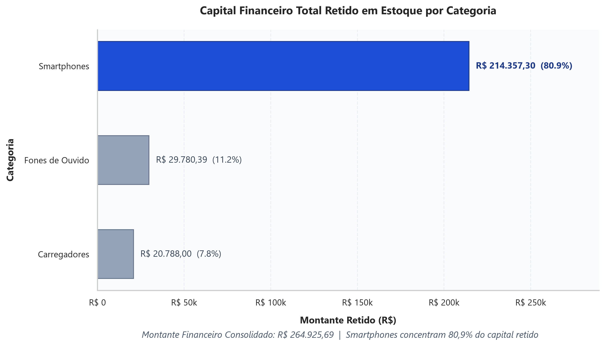
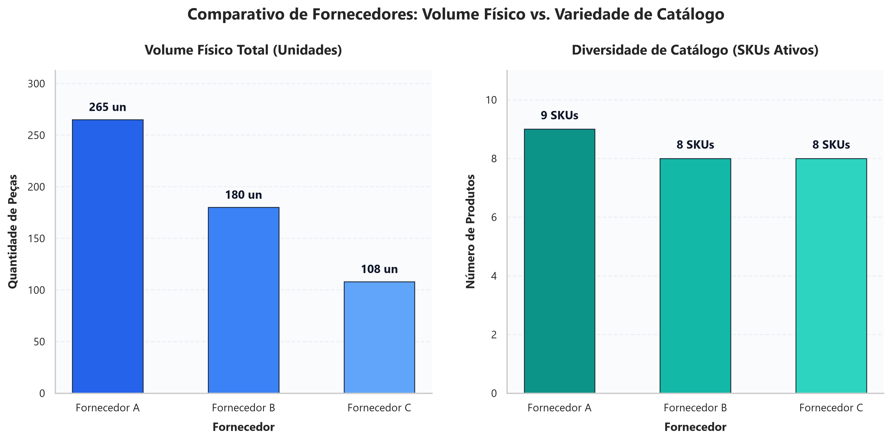
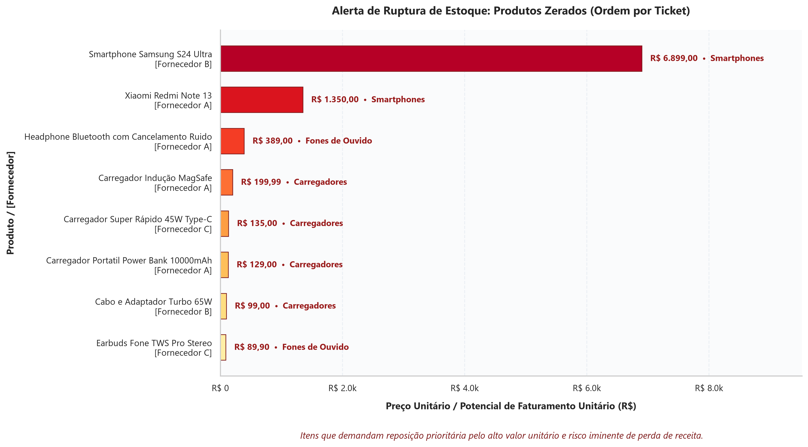

# 📦 Supply Intelligence: Engenharia de Dados, Análise de Estoque & Assistente de IA

[](https://estoque-dashboard-live.streamlit.app)

> 🚀 **Dashboard em Produção:** Acesse a aplicação interativa em tempo real: [estoque-dashboard-live.streamlit.app](https://estoque-dashboard-live.streamlit.app)


[](LICENSE)

Solução modular e automatizada de **Engenharia e Análise de Dados** ponta a ponta desenvolvida em **Python** e **Pandas**, com persistência relacional no **Neon PostgreSQL (Cloud)** com **SQLAlchemy**, orquestração completa do pipeline de ETL, geração de relatórios executivos e disponibilização de um dashboard interativo em tempo real hospedado no **Streamlit Community Cloud**. A plataforma conta agora com um **Assistente Virtual de Suprimentos e Compras com IA Generativa (Google Gemini)** integrado diretamente à base em tempo real, permitindo aos gestores consultar diagnósticos operacionais, recomendações multicritério de cotações de fornecedores e planos de mitigação de rupturas de estoque com streaming nativo e respostas ancoradas nos dados reais do banco. O sistema realiza data profiling, higienização, mapeamento para schema canônico, carga em **Star Schema**, cálculo de indicadores financeiros e auditoria preditiva a partir de fontes de múltiplos fornecedores.

Além disso, um **ranking de risco de fornecedores** avalia cada parceiro por preço, prazo, lote mínimo e **histórico de problemas** (atrasos, defeitos, itens errados, processos judiciais e mais), classificando-os como 🟢 Bom, 🟡 Médio ou 🔴 Perigoso. Essa nota orienta o simulador de recompra e o assistente de IA, sempre mostrando as alternativas para que o usuário tome a decisão final. Tudo em um painel moderno, com tema claro/escuro e versão adaptada para celular.


---


## 🎯 Problema de Negócio


Em ambientes de varejo e comércio eletrônico com múltiplos parceiros de abastecimento, a centralização dos dados de estoque enfrenta obstáculos críticos devido à **heterogeneidade e falta de governança na origem dos arquivos**.


Neste projeto, três fornecedores distintos (**Fornecedor A, Fornecedor B e Fornecedor C**) fornecem diariamente os seus catálogos de produtos com graves problemas de qualidade de dados:


* **Formatos e Schemas Distintos:** Nomes de colunas despadronizados para representar as mesmas entidades (por exemplo: `id_produto` vs `codigo_item` vs `sku`; `preco_unitario` vs `Preco` vs `valor_brl`; `qtd_estoque` vs `Quantidade` vs `estoque_disponivel`).

* **Erros de Digitação e Variações Textuais:** Nomes de produtos e departamentos escritos com erros de digitação e caixas variadas (`"Smartfone"`, `"smarthphone"`, `"FONE DE OUVIDO"`, `"audio / fone ouvido"`, `"Indussão"`, `"bluetoth"`).

* **Divergências de Moeda e Tipos Corrompidos:** Preços inseridos como texto com símbolo de moeda (`"R$ 4.299,00"`), separadores de milhar com ponto e decimais com vírgula, strings com instruções não numéricas (`"consultar"`) e quantidades acompanhadas de texto (`"15 un"`, `"30.0"`).

* **Registros Nulos e Valores Inválidos:** Itens com preços ausentes ou zerados (`0,00`), campos de categoria vazios (`NaN`) e quantidades em estoque negativas (`-3`, `-10`, `-1`) ou registradas como `"SEM ESTOQUE"`.


**Objetivo:** Construir um pipeline resiliente e auditável em Python que converta arquivos heterogêneos e inconsistentes em uma base única e fidedigna (Single Source of Truth), alimente um banco relacional em nuvem (PostgreSQL / Neon) sob modelagem dimensional e disponibilize camadas visuais de consumo analítico para suporte à decisão.

Na etapa de compras, o projeto simula um mercado com **6 fornecedores (A a F)**, cada um com perfil comercial e histórico de ocorrências próprios, para responder à pergunta que importa na reposição: *qual fornecedor é realmente a melhor escolha, considerando preço, prazo, lote e risco?*


---


## 🏗️ Estrutura de Pastas e Arquitetura


O pipeline segue um fluxo lógico desacoplado e modular com arquitetura ponta a ponta conectada à nuvem:

```text
[dados_brutos/] (Fontes Despadronizadas)
       │
       ▼
[exploracao_diagnostico.py] (Profiling: dtypes, nulos, cabeçalhos)
       │
       ▼
[limpeza_padronizacao.py] (ETL: Schema Canônico, Regex, Coerção, Dedução)
       │
       ▼
[dados_processados/estoque_consolidado_limpo.csv] (Base Canônica SSOT)
       │
       ├──▶ [analise_negocio.py] ──▶ [dados_processados/resumo_kpis_categoria.csv]
       │
       ├──▶ [visualizacao_graficos.py] ──▶ [graficos/*.png] (Gráficos Executivos 300 DPI)
       │
       └──▶ [criar_tabelas.py] ──▶ [carregar_dados.py] ──▶ [Neon PostgreSQL (Cloud)]
                                                                   ▲
            [gerar_cotacoes_fornecedores.py] (6 fornecedores) ─────┤
            [gerar_ocorrencias_fornecedores.py] (12 meses) ────────┘
                                                                   │
                       [regras_fornecedores.py] (nota, classe e alternativas)
                                                                   │
                                                                   ▼ (SQLAlchemy / Context Injection)
                                  [Streamlit Community Cloud] ◀──▶ [Google Gemini API → reserva Groq]
                                  (estoque-dashboard-live.streamlit.app)   (GenAI / SDK google-genai)
```

Todas as etapas acima são executadas em sequência pelo orquestrador `pipeline_completo.py`.

### 🛠️ Tecnologias Utilizadas e Nuvem

| Camada | Tecnologia | Finalidade no Projeto |
| :--- | :--- | :--- |
| **Linguagem & Manipulação** | Python 3.11+, Pandas | Engenharia de dados, profiling exploratório, pipeline de ETL e cálculo de KPIs |
| **Banco de Dados (Cloud)** | **Neon PostgreSQL (Cloud)** | Data Warehouse relacional serverless em nuvem com modelagem dimensional (*Star Schema*) |
| **Conectividade & ORM** | SQLAlchemy, psycopg2-binary | Gerenciamento de engine, pool de conexões e execução transacional segura |
| **Inteligência Artificial (GenAI)** | **Google Gemini (3.8 Flash)**, `google-genai`, **Groq** (reserva gratuita, `httpx`) | Assistente virtual de suprimentos, recomendação multicritério de compras e resiliência em cascata |
| **Dashboard & Visualização Interativa** | Streamlit, Plotly, CSS customizado | Aplicação analítica com 6 abas, filtros dinâmicos, tema claro/escuro, animações e layout responsivo para celular |
| **Deploy & Hospedagem em Nuvem** | **Streamlit Community Cloud** | Hospedagem contínua, CI/CD integrado ao GitHub e disponibilização pública da aplicação |
| **Visualização Executiva** | Matplotlib, Seaborn | Geração de gráficos estáticos em alta resolução (300 DPI) para relatórios |
| **Configuração & Controle de Versão** | python-dotenv, Git, GitHub | Gestão segura de variáveis de ambiente (`.env`, `secrets.toml`) e controle de versão |
| **Qualidade & Testes** | pytest | 69 testes automatizados cobrindo limpeza de dados, regras de estoque, ranking de fornecedores e limite do assistente |

### Estrutura do Diretório do Projeto:

```text
pipeline-analise-estoque-python/
│
├── .streamlit/                            # Configurações do Streamlit e credenciais
│   ├── secrets.toml.example               # Modelo de credenciais e segredos (GEMINI_API_KEY, DATABASE_URL)
│   └── secrets.toml                       # Segredos locais ativos (ignorado pelo Git)
│
├── dados_brutos/                          # Arquivos CSV brutos enviados pelos fornecedores
│   ├── fornecedor_a.csv
│   ├── fornecedor_b.csv
│   └── fornecedor_c.csv
│
├── dados_processados/                     # Dados tratados e resumos analíticos exportados
│   ├── estoque_consolidado_limpo.csv
│   └── resumo_kpis_categoria.csv
│
├── graficos/                              # Gráficos executivos gerados em alta resolução
│   ├── valor_por_categoria.png
│   ├── distribuicao_estoque_fornecedor.png
│   └── alerta_ruptura_estoque.png
│
├── gerar_dados_brutos.py                  # Script de simulação de dados e inconsistências
├── exploracao_diagnostico.py              # Script de diagnóstico exploratório e profiling
├── limpeza_padronizacao.py                # Pipeline de higienização, mapeamento e consolidação
├── analise_negocio.py                     # Cálculo de KPIs financeiros e detecção de rupturas
├── visualizacao_graficos.py               # Visualização e renderização gráfica executiva
│
├── criar_tabelas.py                       # DDL: Provisionamento de schemas, tabelas (incl. cotações e ocorrências) e constraints SQL
├── gerar_cotacoes_fornecedores.py         # Simulação e carga de matriz concorrente de cotações (6 fornecedores com perfis)
├── gerar_ocorrencias_fornecedores.py      # Histórico simulado de 12 meses de problemas com fornecedores
├── db.py                                  # Conexão centralizada com o PostgreSQL (usada por todos os scripts)
├── regras_estoque.py                      # Regras de status de reposição (CRITICO, ALERTA, NORMAL, EXCESSO)
├── regras_fornecedores.py                 # Nota única, classificação (Bom/Médio/Perigoso) e motivo dos alertas
├── carregar_dados.py                      # Ingestão dimensional com Upsert no Neon PostgreSQL
├── consultar_banco.py                     # Auditoria pós-carga e consultas SQL analíticas
├── pipeline_completo.py                   # Orquestrador mestre automatizado de ponta a ponta
│
├── assistente_estoque.py                  # Módulo de IA: Chatbot e inteligência de compras com Google Gemini (reserva Groq)
├── app.py                                 # Ponto de entrada do painel Streamlit (filtros, KPIs e abas)
├── dashboard/                             # Módulos do painel Streamlit
│   ├── dados.py                           # Conexão com cache, retry e consultas analíticas
│   ├── estilo.py                          # CSS do painel (tema claro/escuro, animações e abas em pílula)
│   ├── componentes.py                     # Cabeçalho de destaque, cartões de indicadores animados e cartões de alerta dos fornecedores
│   ├── graficos.py                        # Tema único dos gráficos Plotly e paletas de cores
│   ├── formatacao.py                      # Moeda em R$ e exportação Excel estilizada
│   ├── aba_visao_geral.py                 # Aba 1: Visão Geral & Ruptura
│   ├── aba_fornecedores.py                # Aba 2: Análise de Fornecedores
│   ├── aba_compras.py                     # Aba 3: Inteligência de Compras & Cotações
│   ├── aba_ranking.py                     # Aba 4: Ranking & Risco de Fornecedores
│   └── aba_tabela.py                      # Aba 5: Tabela Operacional & Exportação
│
├── requirements.txt                       # Dependências do ambiente Python com versões fixadas
├── requirements-dev.txt                   # Dependências de desenvolvimento (pytest)
├── pytest.ini                             # Configuração dos testes automatizados
├── tests/                                 # Testes da limpeza, das regras de estoque, do ranking de fornecedores e do limite do assistente
├── LICENSE                                # Licença MIT
├── .env                                   # Variáveis de ambiente e credenciais (DATABASE_URL, GEMINI_API_KEY)
├── .gitignore                             # Regras de exclusão do Git
└── README.md                              # Documentação principal do projeto
```


---


## ⚙️ Decisões de Engenharia de Dados


1. **Padronização para Schema Canônico:**

   * Mapeamento explícito das colunas heterogêneas para o padrão unificado: `id_produto`, `produto`, `categoria`, `preco`, `estoque`, `fornecedor`.

   * Preservação da rastreabilidade da origem através da injeção do metadado de fornecedor.


2. **Coerção Numérica e Limpeza de Preços:**

   * Utilização de expressões regulares para remoção do prefixo monetário `R$` e de separadores de milhar no padrão brasileiro (`.` antecedendo 3 dígitos).

   * Substituição da vírgula decimal pelo ponto flutuante padrão do Python.

   * Aplicação de `pd.to_numeric(..., errors='coerce')` para converter textos (ex.: `"consultar"`) em `NaN`.

   * **Auditoria de Descarte:** Registros com preços nulos ou `<= 0` (como itens em revisão a `0,00`) foram removidos com log detalhado, uma vez que preços financeiros não devem ser inventados sem regras de negócio acordadas.


3. **Tratamento de Estoques e Valores Negativos:**

   * Limpeza de sufixos de texto (ex.: `"15 un"`) e mapeamento de valores como `"SEM ESTOQUE"` para `0`.

   * Coerção numérica e retificação de quantidades negativas (`-3`, `-10`, `-1`) para `0` através de `.clip(lower=0)`, saneando inconsistências físicas de estoque.


4. **Normalização de Categorias com Expressões Regulares (Dedução Inteligente):**

   * Normalização de caixas e caracteres para um conjunto fechado de **3 categorias canônicas**: `Smartphones`, `Fones de Ouvido` e `Carregadores`.

   * Quando o campo de categoria se encontrava nulo (`NaN`) ou genérico, o pipeline deduziu automaticamente a categoria através de padrões textuais e expressões regulares aplicados ao nome do produto (ex.: termos como *"Galaxy"*, *"iPhone"*, *"Edge"* e *"Redmi"* classificam automaticamente o produto como *Smartphones*).


5. **Modelagem Dimensional e Armazenamento (PostgreSQL / Neon):**
   * Isolamento lógico em schema dedicado (`core`) para governança analítica.
   * Arquitetura em *Star Schema* composta por tabelas de dimensões (`core.dim_categorias`, `core.dim_produtos`) e tabelas de fatos: `core.fato_estoque` (retratos do estoque), `core.fato_cotacoes` (propostas dos fornecedores) e `core.fato_ocorrencias` (histórico de problemas com fornecedores).
   * Aplicação de regras de integridade defensiva via `CHECK constraints` (`preco_unitario >= 0`, `quantidade_disponivel >= 0`, tipos e status válidos de ocorrência, data de resolução obrigatória só para ocorrências resolvidas) e garantia de idempotência através de operações de *Upsert* (`ON CONFLICT (sku) DO UPDATE`).
   * Conexão centralizada em `db.py`, usada por todos os scripts, e regras de negócio isoladas em módulos sem acesso ao banco (`regras_estoque.py`, `regras_fornecedores.py`), o que permite testá-las automaticamente.


6. **Orquestração Automatizada com Logging Estruturado:**
   * Script centralizador (`pipeline_completo.py`) responsável pelo encadeamento sequencial das 7 fases: simulação dos dados brutos, limpeza, criação das tabelas, carga, cotações, histórico de ocorrências e auditoria final com o ranking de fornecedores.
   * Gestão de execução com métricas de tempo por módulo, rastreamento de falhas com aborto controlado e geração de logs em níveis `INFO` e `ERROR`.


---


## 📊 Indicadores e Métricas Obtidas


A base de dados higienizada consolidou **25 produtos ativos** (com 5 descartes justificados por ausência de preço válido):


### 1. Resumo Executivo Geral

| Indicador de Negócio | Valor Consolidado |

| :--- | :--- |

| **Total de SKUs Válidos** | 25 produtos |

| **Volume Total Físico em Estoque** | 553 unidades |

| **Preço Médio Global** | R$ 1.482,00 |

| **Capital Total Retido em Estoque** | **R$ 264.925,69** |

| **Itens em Ruptura de Estoque (Estoque Zerado)** | 8 SKUs |


### 2. Concentração de Valor por Categoria

| Categoria | SKUs | Unidades em Estoque | Preço Médio | Capital Retido (R$) | Participação (%) |

| :--- | :---: | :---: | :---: | :---: | :---: |

| 📱 **Smartphones** | 9 | 65 | R$ 3.816,03 | **R$ 214.357,30** | **80,91%** |

| 🎧 **Fones de Ouvido** | 9 | 218 | R$ 210,88 | R$ 29.780,39 | 11,24% |

| 🔌 **Carregadores** | 7 | 270 | R$ 115,41 | R$ 20.788,00 | 7,85% |


> **Destaque Estratégico:** Os **Smartphones** representam **80,91% de todo o capital imobilizado** da operação, embora correspondam a apenas 11,7% das unidades físicas totais.


### 3. Identificação de Rupturas de Estoque (Alerta de Reposição)

Foram identificados **8 produtos com estoque zerado**, demandando reposição imediata para evitar perda de receita, com destaque para itens premium:

* **Samsung Galaxy S24 Ultra** (`B-109` - Fornecedor B): Preço Unitário de **R$ 6.899,00**

* **Xiaomi Redmi Note 13** (`FA008` - Fornecedor A): Preço Unitário de **R$ 1.350,00**

* **Headphone Bluetooth ANC** (`FA006` - Fornecedor A): Preço Unitário de **R$ 389,00**


---

## 🛡️ Ranking & Risco de Fornecedores

Além de preço e prazo, o projeto avalia **o histórico de problemas** de cada um dos 6 fornecedores (Fornecedor A a F) para indicar quem é realmente a melhor opção de compra.

* **Histórico de ocorrências (`core.fato_ocorrencias`):** 12 meses simulados de atrasos, itens com defeito ou quebrados, itens errados ou faltando, processos judiciais, divergências de preço ou nota fiscal, falhas de atendimento e avarias no transporte, cada um com gravidade, status (resolvido, em andamento ou em aberto) e tempo de resolução.
* **Nota única (0 a 100):** combina **preço (30%)**, **prazo (20%)**, **lote mínimo (10%)** e **confiabilidade (40%)**. Preço, prazo e lote são comparados com a melhor oferta de cada produto; a confiabilidade parte de 100 e perde pontos conforme a gravidade de cada problema, quando ele aconteceu (problemas resolvidos perdem metade do peso a cada ~4 meses) e se foi resolvido (resolver rápido pesa pouco; problema em aberto pesa o máximo e piora com o tempo).
* **Classificação com alertas:** 🟢 **Bom** (75+), 🟡 **Médio** (50 a 74) e 🔴 **Perigoso** (abaixo de 50). Um processo judicial ou problema crítico sem solução classifica como Perigoso direto, seja qual for a nota. Cada alerta traz o motivo principal (ex.: *"Processo judicial em aberto há 44 dias"*).
* **Simulador de recompra com alternativas:** para cada produto em ruptura ou alerta, o painel recomenda a **melhor opção geral** pela nota e mostra quem vence em cada critério isolado (💰 mais barato, ⚡ mais rápido, 📦 menor lote), com a diferença e o motivo de não ter vencido (ex.: *"🔴 Desclassificado: processo judicial em aberto"*). O usuário vê todas as trocas entre preço, prazo, lote e risco e decide.
* **Assistente de IA ciente do risco:** o Gemini recebe o ranking, a classe de cada fornecedor e as alternativas de cada produto; nunca recomenda um fornecedor 🔴 Perigoso como opção principal e avisa quando ele é o mais barato ou o mais rápido.
* **Regras testadas:** o cálculo fica em `regras_fornecedores.py`, sem acesso ao banco, e é coberto por testes automatizados.

---

## 🤖 Assistente de IA & Inteligência de Compras (Google Gemini + reserva Groq)

> **Reserva gratuita:** se todos os modelos do Gemini falharem (cota esgotada ou instabilidade), a pergunta vai automaticamente para o **Groq** (`gpt-oss-120b` → `gpt-oss-20b` → `qwen3-32b`) com um contexto enxuto, que cabe no limite de tokens do plano gratuito. Cada resposta mostra qual IA respondeu. A reserva é opcional: basta configurar `GROQ_API_KEY`.

O projeto integra um assistente inteligente de ponta a ponta (`assistente_estoque.py`) alimentado pelo **Google Gemini** (modelo padrão `gemini-3.8-flash`), atuando como um consultor executivo sênior de *Supply Chain & Procurement Analytics*. A ferramenta transforma o painel estático em um copiloto de compras proativo, capaz de analisar a saúde dos estoques, cruzar cotações de fornecedores e formular estratégias de mitigação de rupturas com respostas embasadas nos dados reais do banco, injetados no contexto a cada consulta.

### 1. 🧠 Context Injection em Tempo Real (Ground Truth Estruturado)
Diferente de chatbots genéricos desconectados do ecossistema de dados, o assistente utiliza **injeção de contexto em tempo real** diretamente do Data Warehouse (**Neon PostgreSQL / Schema `core`**):
* **Extração Dinâmica de Estado:** A cada consulta, a função `extrair_contexto_executivo_estoque()` consulta a visão unificada do estoque (`core.fato_estoque`, `core.dim_produtos`, `core.dim_categorias`), mapeando SKUs críticos (`quantidade_disponivel = 0`), itens em alerta de ressuprimento (`quantidade_disponivel <= estoque_minimo`) e capital imobilizado.
* **Matriz de Cotações Concorrentes:** Extrai a tabela fato de compras (`core.fato_cotacoes`), identificando para cada SKU a precificação unitária de múltiplos fornecedores, prazos de entrega (*Lead Time* em dias corridos) e lotes mínimos exigidos (*MOQ*).
* **Ranking e Risco de Fornecedores:** Recebe a classe (🟢 Bom, 🟡 Médio, 🔴 Perigoso), a nota e o motivo principal de cada fornecedor, além da **melhor opção geral** de cada produto e das alternativas (mais barata, mais rápida, menor lote) com o motivo de não terem vencido. É calculado pelas mesmas regras do painel (`regras_fornecedores.py`).
* **System Instruction Especializado:** O contexto operacional higienizado é incorporado diretamente nas instruções do sistema (`system_instruction`), garantindo conformidade analítica estrita, vocabulário corporativo de suprimentos (PT-BR) e instrução explícita para não inventar SKUs, preços ou cotações que não estejam no contexto.
* **Tabelas Markdown Mandatórias:** O assistente formata recomendações de reposição prioritariamente em tabelas estruturadas contendo: `Produto Crítico`, `Fornecedor Recomendado`, `Classificação`, `Preço Cotado (R$)`, `Prazo de Entrega (dias)` e `Justificativa da Escolha`.

### 2. 🎯 Apoio à Decisão de Suprimentos & Procurement Multicritério
O assistente foi desenhado para resolver o trade-off clássico de supply chain: **Preço vs. Prazo vs. Capital de Giro vs. Risco do Fornecedor**:
* **Melhor Opção Geral por Padrão:** A IA recomenda o fornecedor com a melhor nota combinada (preço, prazo, lote mínimo e confiabilidade) e mostra a classificação dele em cada recomendação.
* **Proteção contra Fornecedores de Risco:** Um fornecedor 🔴 Perigoso nunca é recomendado como opção principal. Quando ele é o mais barato ou o mais rápido, a IA o cita como alternativa, com aviso e motivo (ex.: *"R$ 11,25 mais barato, mas com processo judicial em aberto"*).
* **Foco em Custo ou Urgência:** Quando a pergunta prioriza menor preço ou reposição imediata, a IA destaca a alternativa mais barata ou mais rápida, sempre comparando com a melhor opção geral e explicitando o risco.
* **Decisão Final do Usuário:** Após a tabela, a IA lista as alternativas com a diferença de preço, prazo ou lote e o motivo de não terem vencido.
* **Chips de Consulta Rápida:** A interface conta com botões de atalho analítico de um clique para perguntas de alta relevância gerencial:
  * `🚨 Produtos Críticos Hoje`: Diagnóstico imediato de rupturas e recomendações de recompra prioritárias.
  * `⏱️ Fornecedores Mais Ágeis`: Mapeamento de menor *Lead Time* por produto para operações de emergência.
  * `💰 Melhores Preços de Cotação`: Matriz de menor custo por SKU e potencial de economia consolidada.

### 3. 🛡️ Arquitetura Leve, Escalável e Resiliente
Toda a integração com a IA foi construída seguindo as melhores práticas de engenharia de software e confiabilidade:
* **SDK Oficial `google-genai`:** Utiliza o SDK moderno de última geração do Google (`from google import genai`), com configurações otimizadas de inferência (`temperature=0.2`, `max_output_tokens=3500`).
* **Failover em Cascata Inteligente (Zero Downtime):** Para assegurar disponibilidade contínua mesmo sob exaustão de cotas gratuitas (código HTTP `429`) ou sobrecarga momentânea dos servidores (código HTTP `503`), o sistema implementa uma cascata prioritária automática:
  $$\text{gemini-3.8-flash} \longrightarrow \text{gemini-3.5-flash} \longrightarrow \text{gemini-flash-lite-latest} \longrightarrow \text{gemini-flash-latest}$$
* **Tempo Limite por Modelo:** Cada modelo da cascata recebe uma única tentativa com tempo limite de 30 s; se travar ou estiver sobrecarregado, a vez passa ao próximo modelo, sem prender o usuário por minutos.
* **Cache de Dados Analíticos (`@st.cache_data`):** A leitura das tabelas no banco de dados é cacheada com `ttl=60`, garantindo agilidade milissegunda na geração do contexto sem onerar a base relacional com queries redundantes.
* **Streaming Fluido & Atômico:** O processamento gera respostas completas sem truncamento ou quebra de frases, sendo entregue ao usuário via streaming nativo do Streamlit (`st.write_stream`).
* **Gestão Transparente de Credenciais:** Suporte nativo a credenciais tanto via `.env` (desenvolvimento local) quanto via `st.secrets` (`.streamlit/secrets.toml` ou painel do Streamlit Community Cloud), com verificação de status em tempo real exibida na interface.
* **Proteção de Cota da API:** Limite de 10 perguntas por sessão (com contador visível), intervalo mínimo de 5 segundos entre envios e no máximo uma tentativa por modelo da cascata, evitando consumo excessivo da API em uma demonstração pública.
* **Erros sem Exposição de Dados:** Detalhes técnicos de falhas (banco ou API) vão apenas para o log do servidor; o visitante vê só uma mensagem amigável.

---

## 🔮 Previsão de Demanda (competição de modelos)

A aba **📈 Previsão de Demanda** (`previsao_demanda.py`) usa o histórico de vendas para prever quando cada produto acaba e quanto comprar:

1. **Calendário da loja detectado nos dados:** dias da semana sem vendas (ex.: fechada aos domingos) e dias atípicos sem nenhuma venda (feriados) ficam fora do cálculo. Lojas online, que vendem todos os dias, são reconhecidas automaticamente.
2. **Competição de modelos por produto:** as últimas semanas do histórico são escondidas e cada modelo tenta prevê-las; vence o de menor erro no total semanal (WAPE):
   * **Holt-Winters (ETS)** com tendência amortecida e sazonalidade semanal (`statsmodels`);
   * **Croston (SBA)** para demanda intermitente (produtos que vendem em dias soltos);
   * **Média móvel semanal** ajustada pelo perfil de cada dia da semana;
   * **Ingênuo sazonal** como referência mínima.
3. **Picos isolados** (promoções, compras atípicas) são limitados para não inflarem a previsão.
4. **Confiança e incerteza:** cada produto mostra o modelo vencedor, o erro no teste (alta / média / baixa) e uma faixa de 90% no gráfico.
5. **Sugestão de compra:** venda prevista até o pedido chegar + período de cobertura + estoque de segurança − estoque atual, arredondada para o **lote mínimo do fornecedor recomendado** (nunca um 🔴 Perigoso). Produtos que vão acabar antes da reposição chegar ganham o alerta **⏳ Ruptura prevista** na Visão Geral, e a previsão também vai para o contexto do assistente de IA.
6. **📝 Pedido de compra em Excel** (`pedido_compra.py`): o usuário marca os itens e ajusta as quantidades numa tabela editável e baixa um Excel com uma aba de **resumo** e **uma aba por fornecedor** (preço, subtotal, lote mínimo, prazo, chegada prevista e motivo da compra). Subtotais e totais são fórmulas, então mudar uma quantidade no Excel atualiza os valores. O mesmo pedido pode ser baixado pela aba de Compras.

Parâmetros ajustáveis na tela: período que a compra deve cobrir, dias de segurança, janela de histórico e prazo de reposição (automático pelo fornecedor ou digitado).

---

## 📈 Demonstração e Visualização

A camada de visualização do projeto é composta por duas frentes complementares: um **dashboard interativo em nuvem** estruturado em 6 abas analíticas para suporte à decisão em tempo real e um conjunto de **gráficos executivos estáticos** para relatórios gerenciais de alta resolução.

---

### 1. 🖥️ Dashboard Interativo em Produção (Streamlit Community Cloud)

[](https://estoque-dashboard-live.streamlit.app)

> 🌐 **Acesso Online:** [estoque-dashboard-live.streamlit.app](https://estoque-dashboard-live.streamlit.app)

A aplicação web interativa foi implantada em produção no **Streamlit Community Cloud** e consome as métricas e tabelas consolidadas diretamente da instância em nuvem do **Neon PostgreSQL (Cloud)** através do **SQLAlchemy**:

* **Integração em Nuvem com SQLAlchemy:** O painel estabelece conexão gerenciada com o banco Neon via `create_engine` e gerencia o ciclo de vida da conexão através do decorador `@st.cache_resource`.
* **Consultas Analíticas Otimizadas:** As métricas são consultadas na tabela fato (`core.fato_estoque`) com junção nas dimensões de produtos (`core.dim_produtos`) e categorias (`core.dim_categorias`), utilizando a sintaxe `DISTINCT ON (p.sku)` ordenada pela carga mais recente (`data_carga DESC`).
* **Cache Inteligente de Baixa Latência:** O carregamento dos dados utiliza `@st.cache_data(ttl=300)` (5 minutos), assegurando tempo de resposta instantâneo aos usuários simultâneos sem sobrecarregar a infraestrutura do banco. O botão **🔄 Atualizar Dados** limpa o cache sob demanda.
* **Interface Moderna e Responsiva:**
  * Cabeçalho com gradiente animado e indicador de conexão ao vivo com o banco.
  * Cartões de indicadores com ícones animados ao passar o mouse: a 📦 caixa recebe eletrônicos, moedas 🪙 caem ao redor do 💰 saco de dinheiro, a 🚨 sirene pisca em vermelho e o ⚠️ triângulo de alerta vibra.
  * Abas em formato de pílula, gráficos com tema único e paleta de cores validada para daltonismo.
  * Tema claro e escuro automáticos, layout adaptado para celular e respeito à preferência de "reduzir movimento" do sistema.
* **Estrutura Modular em 7 Abas Analíticas:**
  1. **📊 Visão Geral & Ruptura:** Gráfico de barras horizontais de capital retido por categoria, gráfico de rosca da distribuição do status de reposição (*CRÍTICO*, *ALERTA*, *NORMAL*, *EXCESSO*) e matriz de recompra prioritária dos produtos zerados. Os indicadores do topo (volume físico, capital imobilizado, produtos críticos e em alerta) ficam visíveis em todas as abas.
  2. **🏭 Análise de Fornecedores:** Indicadores de concentração de suprimentos, share de volume físico e capital imobilizado por parceiro comercial e matriz comparativa de dependência operacional.
  3. **💡 Inteligência de Compras:** Painel de *Procurement Analytics* com auditoria de propostas concorrentes, savings potenciais, matriz de trade-off custo vs. prazo e o **simulador de recompra**: para cada produto em ruptura ou alerta, a melhor opção geral pela nota e uma comparação com as alternativas (💰 mais barata, 🚚💨 mais rápida, 📦 menor lote), com a diferença e o motivo de cada uma não ter vencido, e a lista de todas as ofertas de cada produto (as de fornecedores 🔴 marcadas como não recomendadas).
  4. **🛡️ Ranking & Risco:** Cartões de alerta por fornecedor (🟢 Bom, 🟡 Médio, 🔴 Perigoso) com nota e motivo principal, ranking com a nota de cada fator, mapa de calor dos problemas por tipo, tempo médio de resolução e histórico de ocorrências com filtros.
  5. **📈 Previsão de Demanda:** quanto cada produto deve vender, quando o estoque acaba e quanto comprar de quem (veja a seção abaixo).
  6. **📋 Tabela Operacional & Exportação:** Visualização detalhada em tabela interativa com formatação monetária padrão BRL (R$) e exportação dos dados filtrados em **Excel (.xlsx) estilizado** ou `.csv`.
  7. **🤖 Assistente IA & Compras:** Interface conversacional com o **Google Gemini** (reserva **Groq**), municiada com o contexto do banco de dados e o ranking de fornecedores em tempo real, botões de consulta rápida e recomendações que consideram preço, prazo, lote e risco.

---

### 2. 📊 Relatórios Gráficos Executivos (300 DPI)

Gráficos executivos gerados via `matplotlib` e `seaborn`, utilizando paleta profissional e formatação em moeda nacional:

#### 1. Valor Financeiro por Categoria


#### 2. Comparativo de Fornecedores (Volume Físico vs. SKUs Ativos)


#### 3. Alerta de Ruptura de Estoque (Produtos Zerados por Ticket)


---

## 🚀 Instruções de Execução

Siga o passo a passo abaixo para clonar, configurar e executar todos os estágios do pipeline e o dashboard localmente:

### 1. Clonar o Repositório

```bash
git clone https://github.com/paulocid95/pipeline-de-engenharia-e-analise-de-estoque.git
cd pipeline-de-engenharia-e-analise-de-estoque
```

### 2. Configurar o Ambiente Virtual

* **No Windows (PowerShell):**
  ```powershell
  python -m venv .venv
  .venv\Scripts\Activate.ps1
  ```

* **No Linux / macOS:**
  ```bash
  python3 -m venv .venv
  source .venv/bin/activate
  ```

### 3. Instalar Dependências

```bash
pip install -r requirements.txt
```

> As versões das bibliotecas são fixadas no `requirements.txt` para garantir que o projeto rode igual em qualquer máquina e no Streamlit Cloud (requer Python 3.11 ou mais novo).

### 4. Configurar as Variáveis de Ambiente e Segredos

O sistema suporta credenciais tanto por arquivo `.env` quanto pelo arquivo de segredos nativo do Streamlit (`.streamlit/secrets.toml`).

#### Opção A: Configuração via `.env` (Execução Geral e Scripts Locais)
Crie um arquivo `.env` na raiz do projeto contendo as credenciais de banco e IA:

```env
# Banco de Dados PostgreSQL (Neon Serverless)
DATABASE_URL="postgresql://<usuario>:<senha>@<host>/<database>?sslmode=require"

# Chave de API do Google Gemini (obtenha em: https://aistudio.google.com/app/apikey)
GEMINI_API_KEY="AIzaSy..."

# (Opcional) Reserva gratuita do Groq (obtenha em: https://console.groq.com/keys)
GROQ_API_KEY="gsk_..."
```

#### Opção B: Configuração via `.streamlit/secrets.toml` (Streamlit Local e Nuvem)
Para o Dashboard Streamlit e o Assistente de IA, utilize o modelo disponibilizado em `.streamlit/secrets.toml.example`:

1. Crie o arquivo `.streamlit/secrets.toml`:
   ```toml
   # .streamlit/secrets.toml
   GEMINI_API_KEY = "AIzaSy..."
   DATABASE_URL = "postgresql://<usuario>:<senha>@<host>/<database>?sslmode=require"
   ```

2. **No Streamlit Community Cloud (Deploy em Produção):**
   Acesse as configurações do seu aplicativo em **Settings ➔ Secrets** e cole o conteúdo acima. O Streamlit gerenciará essas credenciais de forma segura sem expô-las no repositório público.

### 5. Executar os Scripts na Ordem Correta

Para processar os dados locais, sincronizar com o banco relacional e carregar as cotações concorrentes, execute:

```bash
# 1. Simular e criar os dados brutos com inconsistências (pasta dados_brutos/)
python gerar_dados_brutos.py

# 2. Executar o diagnóstico exploratório de dados e profiling de inconsistências
python exploracao_diagnostico.py

# 3. Executar o pipeline de limpeza, padronização e consolidação (salva em dados_processados/)
python limpeza_padronizacao.py

# 4. Calcular métricas financeiras de negócio, alertas de ruptura e exportar KPIs
python analise_negocio.py

# 5. Gerar e salvar os gráficos executivos em alta resolução (pasta graficos/)
python visualizacao_graficos.py

# 6. Provisionar o schema relacional e as tabelas (incluindo cotações) no PostgreSQL
python criar_tabelas.py

# 7. Executar a ingestão dimensional com lógica de Upsert no banco de dados
python carregar_dados.py

# 8. Simular a matriz de cotações dos fornecedores e alimentar o banco de dados
python gerar_cotacoes_fornecedores.py

# 9. Gerar o histórico de ocorrências com fornecedores (ranking e risco)
python gerar_ocorrencias_fornecedores.py

# 10. Executar validações, consultas analíticas de auditoria e o ranking de fornecedores
python consultar_banco.py
```

> 💡 **Execução Automatizada:** Você também pode rodar toda a esteira de engenharia de dados com o orquestrador unificado:
> ```bash
> python pipeline_completo.py
> ```

> 🧪 **Testes Automatizados:** 69 testes com `pytest` cobrem as regras de limpeza (preços, estoques, categorias), o status de reposição, o cálculo da nota e a classificação dos fornecedores, a escolha da melhor opção e das alternativas e o limite de perguntas do assistente:
> ```bash
> pip install -r requirements-dev.txt
> pytest
> ```

### 6. Iniciar o Dashboard Interativo Localmente

Para rodar o painel analítico localmente consumindo a base do Neon:

```powershell
streamlit run app.py
```

A aplicação será aberta automaticamente em seu navegador padrão no endereço `http://localhost:8501`.

> 🚀 **Prefere testar sem instalar nada?** Acesse a versão já implantada em produção no [Streamlit Community Cloud](https://estoque-dashboard-live.streamlit.app).


---


## 📄 Licença

Este projeto está sob a licença MIT. Consulte o arquivo [LICENSE](LICENSE) para mais detalhes.

---

## 👨‍💻 Autor


Desenvolvido por **Paulo Cid**  

*Engenharia e Análise de Dados com Python, PostgreSQL & Streamlit*  

GitHub: [@paulocid95](https://github.com/paulocid95)