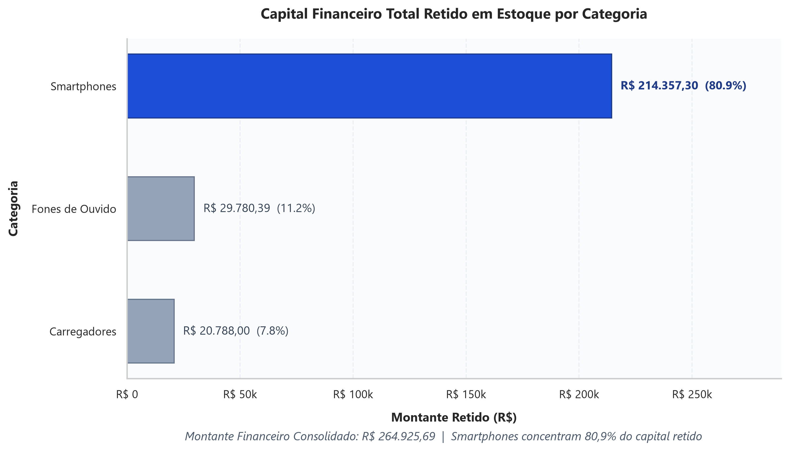
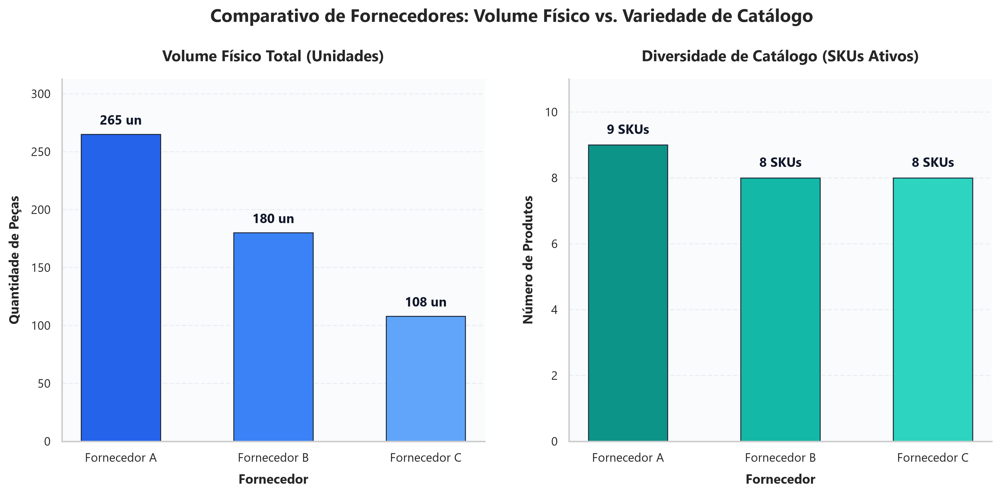
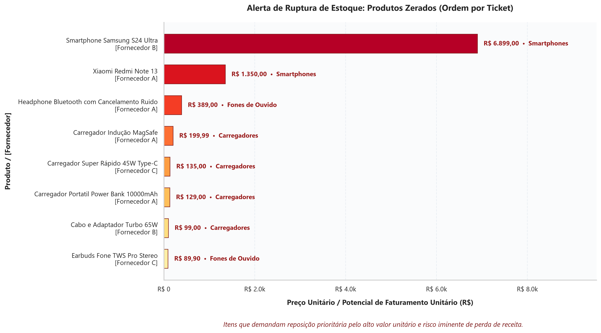

[← Voltar ao README](../README.md)

# 🏗️ Arquitetura e Engenharia de Dados

## 🎯 Problema de Negócio

Em ambientes de varejo e comércio eletrônico com múltiplos parceiros de abastecimento, a centralização dos dados de estoque enfrenta obstáculos críticos devido à **heterogeneidade e falta de governança na origem dos arquivos**.

Neste projeto, três fornecedores distintos (**Fornecedor A, Fornecedor B e Fornecedor C**) fornecem diariamente os seus catálogos de produtos com graves problemas de qualidade de dados:

* **Formatos e Schemas Distintos:** Nomes de colunas despadronizados para representar as mesmas entidades (por exemplo: `id_produto` vs `codigo_item` vs `sku`; `preco_unitario` vs `Preco` vs `valor_brl`; `qtd_estoque` vs `Quantidade` vs `estoque_disponivel`).

* **Erros de Digitação e Variações Textuais:** Nomes de produtos e departamentos escritos com erros de digitação e caixas variadas (`"Smartfone"`, `"smarthphone"`, `"FONE DE OUVIDO"`, `"audio / fone ouvido"`, `"Indussão"`, `"bluetoth"`).

* **Divergências de Moeda e Tipos Corrompidos:** Preços inseridos como texto com símbolo de moeda (`"R$ 4.299,00"`), separadores de milhar com ponto e decimais com vírgula, strings com instruções não numéricas (`"consultar"`) e quantidades acompanhadas de texto (`"15 un"`, `"30.0"`).

* **Registros Nulos e Valores Inválidos:** Itens com preços ausentes ou zerados (`0,00`), campos de categoria vazios (`NaN`) e quantidades em estoque negativas (`-3`, `-10`, `-1`) ou registradas como `"SEM ESTOQUE"`.

**Objetivo:** Construir um pipeline resiliente e auditável em Python que converta arquivos heterogêneos e inconsistentes em uma base única e fidedigna (Single Source of Truth), alimente um banco relacional em nuvem (PostgreSQL / Neon) sob modelagem dimensional e disponibilize camadas visuais de consumo analítico para suporte à decisão.

Na etapa de compras, o projeto simula um mercado com **6 fornecedores (A a F)**, cada um com perfil comercial e histórico de ocorrências próprios, para responder à pergunta que importa na reposição: *qual fornecedor é realmente a melhor escolha, considerando preço, prazo, lote e risco?*

---

## Fluxo do pipeline

O pipeline segue um fluxo lógico desacoplado e modular com arquitetura ponta a ponta conectada à nuvem:

```text
[dados_brutos/] (Fontes Despadronizadas)
       │
       ▼
[exploracao_diagnostico.py] (Profiling: dtypes, nulos, cabeçalhos)
       │
       ▼
[limpeza_padronizacao.py] (ETL: Schema Canônico, Regex, Coerção, Dedução)
       │
       ▼
[dados_processados/estoque_consolidado_limpo.csv] (Base Canônica SSOT)
       │
       ├──▶ [analise_negocio.py] ──▶ [dados_processados/resumo_kpis_categoria.csv]
       │
       ├──▶ [visualizacao_graficos.py] ──▶ [graficos/*.png] (Gráficos Executivos 300 DPI)
       │
       └──▶ [criar_tabelas.py] ──▶ [carregar_dados.py] ──▶ [Neon PostgreSQL (Cloud)]
                                                                   ▲
            [gerar_cotacoes_fornecedores.py] (6 fornecedores) ─────┤
            [gerar_ocorrencias_fornecedores.py] (12 meses) ────────┘
                                                                   │
                       [regras_fornecedores.py] (nota, classe e alternativas)
                                                                   │
                                                                   ▼ (SQLAlchemy / Context Injection)
                                  [Streamlit Community Cloud] ◀──▶ [Google Gemini API → reserva Groq]
                                  (estoque-dashboard-live.streamlit.app)   (GenAI / SDK google-genai)
```

Todas as etapas acima são executadas em sequência pelo orquestrador `pipeline_completo.py`.

### 🛠️ Tecnologias Utilizadas e Nuvem

| Camada | Tecnologia | Finalidade no Projeto |
| :--- | :--- | :--- |
| **Linguagem & Manipulação** | Python 3.11+, Pandas | Engenharia de dados, profiling exploratório, pipeline de ETL e cálculo de KPIs |
| **Banco de Dados (Cloud)** | **Neon PostgreSQL (Cloud)** | Data Warehouse relacional serverless em nuvem com modelagem dimensional (*Star Schema*) |
| **Conectividade & ORM** | SQLAlchemy, psycopg2-binary | Gerenciamento de engine, pool de conexões e execução transacional segura |
| **Inteligência Artificial (GenAI)** | **Google Gemini (3.8 Flash)**, `google-genai`, **Groq** (reserva gratuita, `httpx`) | Assistente virtual de suprimentos, recomendação multicritério de compras e resiliência em cascata |
| **Dashboard & Visualização Interativa** | Streamlit, Plotly, CSS customizado | Página inicial, envio de planilha e painel com 7 abas, filtros dinâmicos, tema claro/escuro, animações e layout responsivo para celular |
| **Previsão de Demanda** | statsmodels (Holt-Winters), NumPy | Competição de modelos por produto, faixa de incerteza e sugestão de compra |
| **Planilhas** | openpyxl | Leitura das planilhas enviadas, planilha higienizada e pedido de compra em Excel |
| **Deploy & Hospedagem em Nuvem** | **Streamlit Community Cloud** | Hospedagem contínua, CI/CD integrado ao GitHub e disponibilização pública da aplicação |
| **Visualização Executiva** | Matplotlib, Seaborn | Geração de gráficos estáticos em alta resolução (300 DPI) para relatórios |
| **Configuração & Controle de Versão** | python-dotenv, Git, GitHub | Gestão segura de variáveis de ambiente (`.env`, `secrets.toml`) e controle de versão |
| **Qualidade & Testes** | pytest | Mais de 200 testes automatizados: limpeza e higienização, regras de estoque, ranking de fornecedores, previsão de demanda, pedido de compra e assistente de IA |

Além do pipeline acima (dados da demonstração), o app aceita **a planilha do próprio usuário**: o pacote `higienizacao/` faz o mesmo trabalho de limpeza na hora, só na sessão do navegador, sem gravar nada no banco. Veja [Envio e higienização de planilhas](higienizacao.md).

### Estrutura do diretório

```text
supply-intelligence/
│
├── app.py                          # Entrada do Streamlit: página inicial, envio de planilha ou painel
├── dashboard/                      # Interface
│   ├── pagina_inicial.py           # Página de apresentação (inicio/estilo.css e inicio/efeitos.js)
│   ├── pagina_envio.py             # Envio, conferência e revisão da planilha do usuário
│   ├── painel.py                   # Painel com as 7 abas (demonstração ou dados do usuário)
│   ├── aba_visao_geral.py          # Visão Geral & Ruptura (com a ruptura prevista)
│   ├── aba_fornecedores.py         # Análise de Fornecedores
│   ├── aba_compras.py              # Inteligência de Compras e simulador de recompra
│   ├── aba_ranking.py              # Ranking & Risco de fornecedores
│   ├── aba_previsao.py             # Previsão de Demanda
│   ├── pedido.py                   # Pedido de compra editável e download
│   ├── aba_tabela.py               # Tabela operacional e exportação
│   ├── componentes.py, estilo.py, graficos.py, formatacao.py, dados.py
│
├── higienizacao/                   # Limpeza das planilhas enviadas
│   ├── leitura.py                  # Excel/CSV, várias abas, cabeçalho fora da linha 1
│   ├── colunas.py                  # Reconhece o tipo de tabela e o nome de cada coluna
│   ├── conversores.py, texto.py    # Preços, quantidades, datas e textos bagunçados
│   ├── entidades.py                # Unifica grafias de fornecedores, produtos e categorias
│   ├── processador.py              # Orquestra a limpeza e monta o relatório
│   └── exportacao.py               # Planilha higienizada para download
│
├── previsao_demanda.py             # Calendário da loja, competição de modelos e sugestão de compra
├── pedido_compra.py                # Pedido de compra em Excel (resumo + uma aba por fornecedor)
├── regras_estoque.py               # Status de reposição (CRÍTICO, ALERTA, NORMAL, EXCESSO)
├── regras_fornecedores.py          # Nota, classe (Bom/Médio/Perigoso) e alternativas de compra
├── assistente_estoque.py           # Assistente de IA (Gemini com reserva Groq)
├── simulacao_vendas.py             # Histórico de vendas da demonstração
├── planilha_exemplo.py             # Planilha de exemplo "bagunçada de propósito"
├── datas_relativas.py              # Datas da demonstração sempre relativas a hoje
│
├── gerar_dados_brutos.py           # Pipeline: simula os arquivos dos fornecedores
├── exploracao_diagnostico.py       # Pipeline: profiling
├── limpeza_padronizacao.py         # Pipeline: limpeza e schema canônico
├── analise_negocio.py              # Pipeline: KPIs
├── visualizacao_graficos.py        # Pipeline: gráficos 300 DPI
├── criar_tabelas.py, carregar_dados.py, consultar_banco.py, db.py
├── gerar_cotacoes_fornecedores.py, gerar_ocorrencias_fornecedores.py
├── pipeline_completo.py            # Orquestrador de todas as etapas
│
├── dados_brutos/, dados_processados/, graficos/
├── docs/                           # Esta documentação e os prints (docs/img)
├── tests/                          # Testes automatizados (pytest)
└── requirements.txt, requirements-dev.txt, pytest.ini, .streamlit/secrets.toml.example
```

---

## ⚙️ Decisões de Engenharia de Dados

1. **Padronização para Schema Canônico:**

   * Mapeamento explícito das colunas heterogêneas para o padrão unificado: `id_produto`, `produto`, `categoria`, `preco`, `estoque`, `fornecedor`.

   * Preservação da rastreabilidade da origem através da injeção do metadado de fornecedor.

2. **Coerção Numérica e Limpeza de Preços:**

   * Utilização de expressões regulares para remoção do prefixo monetário `R$` e de separadores de milhar no padrão brasileiro (`.` antecedendo 3 dígitos).

   * Substituição da vírgula decimal pelo ponto flutuante padrão do Python.

   * Aplicação de `pd.to_numeric(..., errors='coerce')` para converter textos (ex.: `"consultar"`) em `NaN`.

   * **Auditoria de Descarte:** Registros com preços nulos ou `<= 0` (como itens em revisão a `0,00`) foram removidos com log detalhado, uma vez que preços financeiros não devem ser inventados sem regras de negócio acordadas.

3. **Tratamento de Estoques e Valores Negativos:**

   * Limpeza de sufixos de texto (ex.: `"15 un"`) e mapeamento de valores como `"SEM ESTOQUE"` para `0`.

   * Coerção numérica e retificação de quantidades negativas (`-3`, `-10`, `-1`) para `0` através de `.clip(lower=0)`, saneando inconsistências físicas de estoque.

4. **Normalização de Categorias com Expressões Regulares (Dedução Inteligente):**

   * Normalização de caixas e caracteres para um conjunto fechado de **3 categorias canônicas**: `Smartphones`, `Fones de Ouvido` e `Carregadores`.

   * Quando o campo de categoria se encontrava nulo (`NaN`) ou genérico, o pipeline deduziu automaticamente a categoria através de padrões textuais e expressões regulares aplicados ao nome do produto (ex.: termos como *"Galaxy"*, *"iPhone"*, *"Edge"* e *"Redmi"* classificam automaticamente o produto como *Smartphones*).

5. **Modelagem Dimensional e Armazenamento (PostgreSQL / Neon):**
   * Isolamento lógico em schema dedicado (`core`) para governança analítica.
   * Arquitetura em *Star Schema* composta por tabelas de dimensões (`core.dim_categorias`, `core.dim_produtos`) e tabelas de fatos: `core.fato_estoque` (retratos do estoque), `core.fato_cotacoes` (propostas dos fornecedores) e `core.fato_ocorrencias` (histórico de problemas com fornecedores).
   * Aplicação de regras de integridade defensiva via `CHECK constraints` (`preco_unitario >= 0`, `quantidade_disponivel >= 0`, tipos e status válidos de ocorrência, data de resolução obrigatória só para ocorrências resolvidas) e garantia de idempotência através de operações de *Upsert* (`ON CONFLICT (sku) DO UPDATE`).
   * Conexão centralizada em `db.py`, usada por todos os scripts, e regras de negócio isoladas em módulos sem acesso ao banco (`regras_estoque.py`, `regras_fornecedores.py`), o que permite testá-las automaticamente.

6. **Orquestração Automatizada com Logging Estruturado:**
   * Script centralizador (`pipeline_completo.py`) responsável pelo encadeamento sequencial das 7 fases: simulação dos dados brutos, limpeza, criação das tabelas, carga, cotações, histórico de ocorrências e auditoria final com o ranking de fornecedores.
   * Gestão de execução com métricas de tempo por módulo, rastreamento de falhas com aborto controlado e geração de logs em níveis `INFO` e `ERROR`.

---

## 📊 Indicadores e Métricas Obtidas

A base de dados higienizada consolidou **25 produtos ativos** (com 5 descartes justificados por ausência de preço válido):

### 1. Resumo Executivo Geral

| Indicador de Negócio | Valor Consolidado |
| :--- | :--- |
| **Total de SKUs Válidos** | 25 produtos |
| **Volume Total Físico em Estoque** | 553 unidades |
| **Preço Médio Global** | R$ 1.482,00 |
| **Capital Total Retido em Estoque** | **R$ 264.925,69** |
| **Itens em Ruptura de Estoque (Estoque Zerado)** | 8 SKUs |

### 2. Concentração de Valor por Categoria

| Categoria | SKUs | Unidades em Estoque | Preço Médio | Capital Retido (R$) | Participação (%) |
| :--- | :---: | :---: | :---: | :---: | :---: |
| 📱 **Smartphones** | 9 | 65 | R$ 3.816,03 | **R$ 214.357,30** | **80,91%** |
| 🎧 **Fones de Ouvido** | 9 | 218 | R$ 210,88 | R$ 29.780,39 | 11,24% |
| 🔌 **Carregadores** | 7 | 270 | R$ 115,41 | R$ 20.788,00 | 7,85% |

> **Destaque Estratégico:** Os **Smartphones** representam **80,91% de todo o capital imobilizado** da operação, embora correspondam a apenas 11,7% das unidades físicas totais.

### 3. Identificação de Rupturas de Estoque (Alerta de Reposição)

Foram identificados **8 produtos com estoque zerado**, demandando reposição imediata para evitar perda de receita, com destaque para itens premium:

* **Samsung Galaxy S24 Ultra** (`B-109` - Fornecedor B): Preço Unitário de **R$ 6.899,00**

* **Xiaomi Redmi Note 13** (`FA008` - Fornecedor A): Preço Unitário de **R$ 1.350,00**

* **Headphone Bluetooth ANC** (`FA006` - Fornecedor A): Preço Unitário de **R$ 389,00**

---

## 🖥️ Painel em produção

A aplicação web interativa foi implantada em produção no **Streamlit Community Cloud** e consome as métricas e tabelas consolidadas diretamente da instância em nuvem do **Neon PostgreSQL (Cloud)** através do **SQLAlchemy**:

* **Integração em Nuvem com SQLAlchemy:** O painel estabelece conexão gerenciada com o banco Neon via `create_engine` e gerencia o ciclo de vida da conexão através do decorador `@st.cache_resource`.
* **Consultas Analíticas Otimizadas:** As métricas são consultadas na tabela fato (`core.fato_estoque`) com junção nas dimensões de produtos (`core.dim_produtos`) e categorias (`core.dim_categorias`), utilizando a sintaxe `DISTINCT ON (p.sku)` ordenada pela carga mais recente (`data_carga DESC`).
* **Cache Inteligente de Baixa Latência:** O carregamento dos dados utiliza `@st.cache_data(ttl=300)` (5 minutos), assegurando tempo de resposta instantâneo aos usuários simultâneos sem sobrecarregar a infraestrutura do banco. O botão **🔄 Atualizar Dados** limpa o cache sob demanda.
* **Interface Moderna e Responsiva:**
  * Cabeçalho com gradiente animado e indicador de conexão ao vivo com o banco.
  * Cartões de indicadores com ícones animados ao passar o mouse: a 📦 caixa recebe eletrônicos, moedas 🪙 caem ao redor do 💰 saco de dinheiro, a 🚨 sirene pisca em vermelho e o ⚠️ triângulo de alerta vibra.
  * Abas em formato de pílula, gráficos com tema único e paleta de cores validada para daltonismo.
  * Tema claro e escuro automáticos, layout adaptado para celular e respeito à preferência de "reduzir movimento" do sistema.

---

## 📊 Relatórios Gráficos Executivos (300 DPI)

Gráficos executivos gerados via `matplotlib` e `seaborn`, utilizando paleta profissional e formatação em moeda nacional:

### 1. Valor Financeiro por Categoria


### 2. Comparativo de Fornecedores (Volume Físico vs. SKUs Ativos)


### 3. Alerta de Ruptura de Estoque (Produtos Zerados por Ticket)

