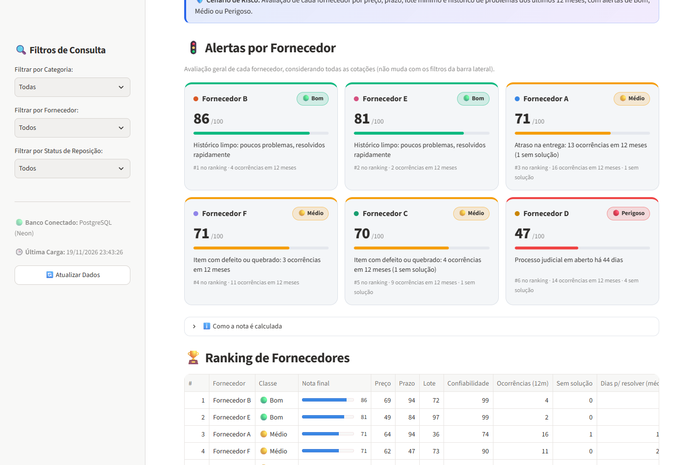
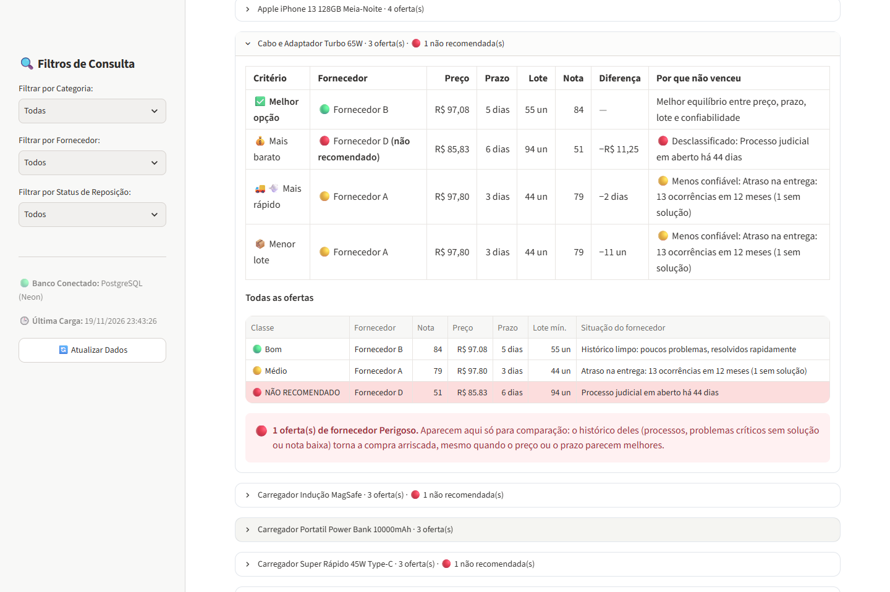
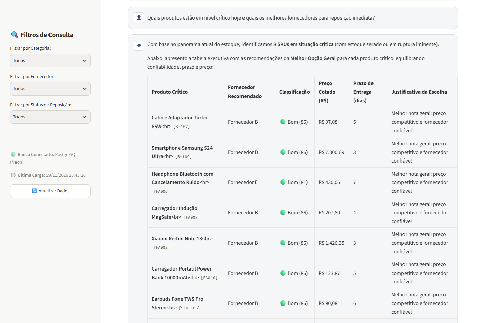

[← Voltar ao README](../README.md)

# 🛡️ Fornecedores e Assistente de IA

## 🛡️ Ranking & Risco de Fornecedores

Além de preço e prazo, o projeto avalia **o histórico de problemas** de cada um dos 6 fornecedores (Fornecedor A a F) para indicar quem é realmente a melhor opção de compra.

* **Histórico de ocorrências (`core.fato_ocorrencias`):** 12 meses simulados de atrasos, itens com defeito ou quebrados, itens errados ou faltando, processos judiciais, divergências de preço ou nota fiscal, falhas de atendimento e avarias no transporte, cada um com gravidade, status (resolvido, em andamento ou em aberto) e tempo de resolução.
* **Nota única (0 a 100):** combina **preço (30%)**, **prazo (20%)**, **lote mínimo (10%)** e **confiabilidade (40%)**. Preço, prazo e lote são comparados com a melhor oferta de cada produto; a confiabilidade parte de 100 e perde pontos conforme a gravidade de cada problema, quando ele aconteceu (problemas resolvidos perdem metade do peso a cada ~4 meses) e se foi resolvido (resolver rápido pesa pouco; problema em aberto pesa o máximo e piora com o tempo).
* **Classificação com alertas:** 🟢 **Bom** (75+), 🟡 **Médio** (50 a 74) e 🔴 **Perigoso** (abaixo de 50). Um processo judicial ou problema crítico sem solução classifica como Perigoso direto, seja qual for a nota. Cada alerta traz o motivo principal (ex.: *"Processo judicial em aberto há 44 dias"*).
* **Simulador de recompra com alternativas:** para cada produto em ruptura ou alerta, o painel recomenda a **melhor opção geral** pela nota e mostra quem vence em cada critério isolado (💰 mais barato, 🚚💨 mais rápido, 📦 menor lote), com a diferença e o motivo de não ter vencido (ex.: *"🔴 Desclassificado: processo judicial em aberto"*). O usuário vê todas as trocas entre preço, prazo, lote e risco e decide.
* **Todas as ofertas, inclusive as ruins:** cada produto em risco tem a lista completa de ofertas; as de fornecedores 🔴 aparecem em vermelho como *não recomendadas*, com o motivo.

  

* **Assistente de IA ciente do risco:** o Gemini recebe o ranking, a classe de cada fornecedor e as alternativas de cada produto; nunca recomenda um fornecedor 🔴 Perigoso como opção principal e avisa quando ele é o mais barato ou o mais rápido.
* **Regras testadas:** o cálculo fica em `regras_fornecedores.py`, sem acesso ao banco, e é coberto por testes automatizados.

---

## 🤖 Assistente de IA & Inteligência de Compras (Google Gemini + reserva Groq)

> **Reserva gratuita:** se todos os modelos do Gemini falharem (cota esgotada ou instabilidade), a pergunta vai automaticamente para o **Groq** (`gpt-oss-120b` → `gpt-oss-20b` → `qwen3-32b`) com um contexto enxuto, que cabe no limite de tokens do plano gratuito. Cada resposta mostra qual IA respondeu. A reserva é opcional: basta configurar `GROQ_API_KEY`.

O projeto integra um assistente inteligente de ponta a ponta (`assistente_estoque.py`) alimentado pelo **Google Gemini** (modelo padrão `gemini-3.8-flash`), atuando como um consultor executivo sênior de *Supply Chain & Procurement Analytics*. A ferramenta transforma o painel estático em um copiloto de compras proativo, capaz de analisar a saúde dos estoques, cruzar cotações de fornecedores e formular estratégias de mitigação de rupturas com respostas embasadas nos dados reais do banco, injetados no contexto a cada consulta.

### 1. 🧠 Context Injection em Tempo Real (Ground Truth Estruturado)
Diferente de chatbots genéricos desconectados do ecossistema de dados, o assistente utiliza **injeção de contexto em tempo real** diretamente do Data Warehouse (**Neon PostgreSQL / Schema `core`**):
* **Extração Dinâmica de Estado:** A cada consulta, a função `extrair_contexto_executivo_estoque()` consulta a visão unificada do estoque (`core.fato_estoque`, `core.dim_produtos`, `core.dim_categorias`), mapeando SKUs críticos (`quantidade_disponivel = 0`), itens em alerta de ressuprimento (`quantidade_disponivel <= estoque_minimo`) e capital imobilizado.
* **Matriz de Cotações Concorrentes:** Extrai a tabela fato de compras (`core.fato_cotacoes`), identificando para cada SKU a precificação unitária de múltiplos fornecedores, prazos de entrega (*Lead Time* em dias corridos) e lotes mínimos exigidos (*MOQ*).
* **Ranking e Risco de Fornecedores:** Recebe a classe (🟢 Bom, 🟡 Médio, 🔴 Perigoso), a nota e o motivo principal de cada fornecedor, além da **melhor opção geral** de cada produto e das alternativas (mais barata, mais rápida, menor lote) com o motivo de não terem vencido. É calculado pelas mesmas regras do painel (`regras_fornecedores.py`).
* **System Instruction Especializado:** O contexto operacional higienizado é incorporado diretamente nas instruções do sistema (`system_instruction`), garantindo conformidade analítica estrita, vocabulário corporativo de suprimentos (PT-BR) e instrução explícita para não inventar SKUs, preços ou cotações que não estejam no contexto.
* **Tabelas Markdown Mandatórias:** O assistente formata recomendações de reposição prioritariamente em tabelas estruturadas contendo: `Produto Crítico`, `Fornecedor Recomendado`, `Classificação`, `Preço Cotado (R$)`, `Prazo de Entrega (dias)` e `Justificativa da Escolha`.

### 2. 🎯 Apoio à Decisão de Suprimentos & Procurement Multicritério
O assistente foi desenhado para resolver o trade-off clássico de supply chain: **Preço vs. Prazo vs. Capital de Giro vs. Risco do Fornecedor**:
* **Melhor Opção Geral por Padrão:** A IA recomenda o fornecedor com a melhor nota combinada (preço, prazo, lote mínimo e confiabilidade) e mostra a classificação dele em cada recomendação.
* **Proteção contra Fornecedores de Risco:** Um fornecedor 🔴 Perigoso nunca é recomendado como opção principal. Quando ele é o mais barato ou o mais rápido, a IA o cita como alternativa, com aviso e motivo (ex.: *"R$ 11,25 mais barato, mas com processo judicial em aberto"*).
* **Foco em Custo ou Urgência:** Quando a pergunta prioriza menor preço ou reposição imediata, a IA destaca a alternativa mais barata ou mais rápida, sempre comparando com a melhor opção geral e explicitando o risco.
* **Decisão Final do Usuário:** Após a tabela, a IA lista as alternativas com a diferença de preço, prazo ou lote e o motivo de não terem vencido.
* **Chips de Consulta Rápida:** A interface conta com botões de atalho analítico de um clique para perguntas de alta relevância gerencial:
  * `🚨 Produtos Críticos Hoje`: Diagnóstico imediato de rupturas e recomendações de recompra prioritárias.
  * `⏱️ Fornecedores Mais Ágeis`: Mapeamento de menor *Lead Time* por produto para operações de emergência.
  * `💰 Melhores Preços de Cotação`: Matriz de menor custo por SKU e potencial de economia consolidada.

### 3. 🛡️ Arquitetura Leve, Escalável e Resiliente
Toda a integração com a IA foi construída seguindo as melhores práticas de engenharia de software e confiabilidade:
* **SDK Oficial `google-genai`:** Utiliza o SDK moderno de última geração do Google (`from google import genai`), com configurações otimizadas de inferência (`temperature=0.2`, `max_output_tokens=3500`).
* **Failover em Cascata Inteligente (Zero Downtime):** Para assegurar disponibilidade contínua mesmo sob exaustão de cotas gratuitas (código HTTP `429`) ou sobrecarga momentânea dos servidores (código HTTP `503`), o sistema implementa uma cascata prioritária automática:
  $$\text{gemini-3.8-flash} \longrightarrow \text{gemini-3.5-flash} \longrightarrow \text{gemini-flash-lite-latest} \longrightarrow \text{gemini-flash-latest}$$
* **Tempo Limite por Modelo:** Cada modelo da cascata recebe uma única tentativa com tempo limite de 30 s; se travar ou estiver sobrecarregado, a vez passa ao próximo modelo, sem prender o usuário por minutos.
* **Cache de Dados Analíticos (`@st.cache_data`):** A leitura das tabelas no banco de dados é cacheada com `ttl=60`, garantindo agilidade milissegunda na geração do contexto sem onerar a base relacional com queries redundantes.
* **Streaming Fluido & Atômico:** O processamento gera respostas completas sem truncamento ou quebra de frases, sendo entregue ao usuário via streaming nativo do Streamlit (`st.write_stream`).
* **Gestão Transparente de Credenciais:** Suporte nativo a credenciais tanto via `.env` (desenvolvimento local) quanto via `st.secrets` (`.streamlit/secrets.toml` ou painel do Streamlit Community Cloud), com verificação de status em tempo real exibida na interface.
* **Proteção de Cota da API:** Limite de 10 perguntas por sessão (com contador visível), intervalo mínimo de 5 segundos entre envios e no máximo uma tentativa por modelo da cascata, evitando consumo excessivo da API em uma demonstração pública.
* **Erros sem Exposição de Dados:** Detalhes técnicos de falhas (banco ou API) vão apenas para o log do servidor; o visitante vê só uma mensagem amigável.
