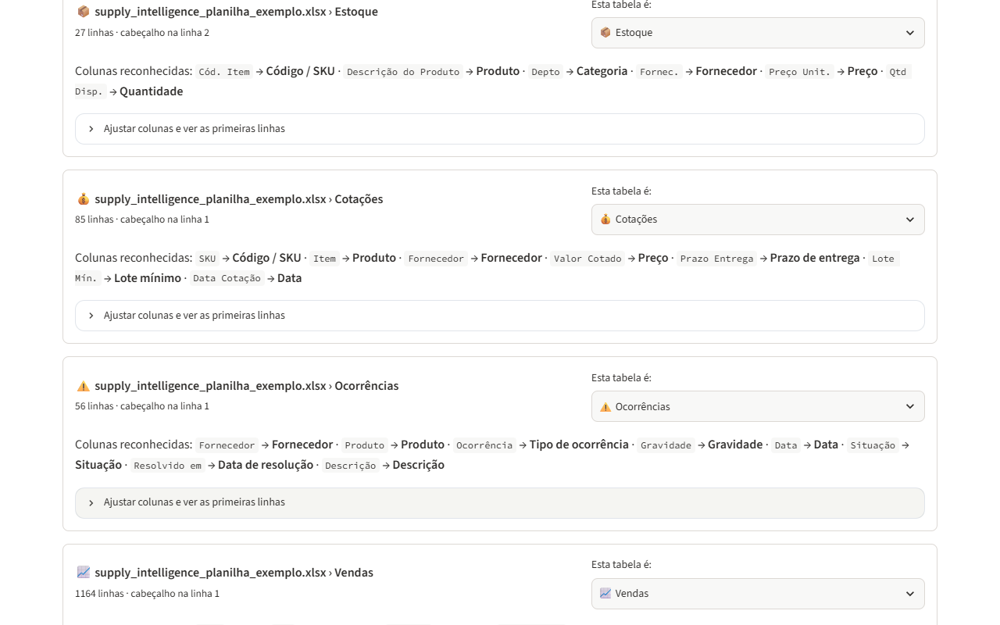

[← Voltar ao README](../README.md)

# 🧹 Envio e higienização de planilhas

Além da demonstração, qualquer pessoa pode enviar **a própria planilha** e ver o mesmo painel com os seus dados. O pacote `higienizacao/` recebe o arquivo do jeito que ele sai do sistema da loja e faz a limpeza na hora.

## O que pode ser enviado

Excel (`.xlsx`, `.xls`) com várias abas ou arquivos CSV separados, até **5 MB** e **10.000 linhas** por arquivo. Os nomes das colunas não precisam ser iguais aos nossos.

| Dado | Colunas obrigatórias | Opcionais | O que libera |
| :--- | :--- | :--- | :--- |
| 📦 **Estoque** | produto, quantidade, preço | código/SKU, categoria, fornecedor, estoque mínimo | Visão geral, alertas de ruptura, tabela e assistente de IA |
| 💰 **Cotações** | produto (ou SKU), fornecedor, preço | prazo de entrega, lote mínimo | Comparação de fornecedores e simulador de recompra |
| ⚠️ **Ocorrências** | fornecedor, tipo, data | gravidade, situação, data de resolução | Ranking & Risco com o histórico de problemas |
| 📈 **Vendas** | data, produto (ou SKU), quantidade vendida | — | Previsão de demanda e pedido de compra |

Só o Estoque é obrigatório. Quando falta uma tabela, a aba correspondente explica o que ela liberaria e oferece enviar outra planilha.

## Como funciona

1. **Leitura (`leitura.py`):** abre cada aba ou CSV, acha o cabeçalho mesmo quando há linhas de título acima dele e ignora linhas de TOTAL/subtotal.
2. **Reconhecimento (`colunas.py`):** descobre qual tabela é cada aba (estoque, cotações, ocorrências ou vendas) e qual coluna é qual, por sinônimos e pelo conteúdo. O usuário confere e pode corrigir antes de continuar.
3. **Limpeza (`conversores.py`, `texto.py`):** preços como `"R$ 1.299,90"` ou `"1299.9"`, quantidades como `"12 un"`, datas em vários formatos e textos com espaços e maiúsculas misturadas.
4. **Unificação (`entidades.py`):** grafias diferentes do mesmo fornecedor (`"FORNECEDOR B LTDA"`, `"Forn. B"`) viram um nome só; produtos repetidos são somados; categorias vazias são deduzidas pelos produtos parecidos da própria planilha. Quando um nome contém o outro (`"Mundo Pet"` e `"Mundo Pet Atacado"`), eles já vêm unidos e o usuário pode separar; os demais casos duvidosos só são unidos se o usuário confirmar. As categorias da planilha são mantidas: a tradução para as categorias de eletrônicos só vale quando a maioria dos produtos é de eletrônicos.
5. **Preço de compra primeiro:** quando a planilha tem custo e preço de venda, o sistema usa o custo, que é o que vale para o valor do estoque e para comparar com as cotações.
6. **Relatório (`processador.py`):** cada correção aparece na tela com exemplos (antes → depois) e as linhas descartadas mostram o motivo.
7. **Planilha higienizada (`exportacao.py`):** o usuário baixa os dados limpos em Excel, com uma aba de relatório da limpeza. O arquivo pode ser enviado de novo sem perder nada.

## Privacidade

Os dados ficam **só na sessão do navegador**: nada é gravado no banco, e tudo some quando a página é fechada. Quando o usuário usa o assistente, as perguntas e um resumo dos dados são enviados ao Google Gemini (ou ao Groq, se o Gemini falhar), e o app avisa isso na tela.

Para testar sem dados próprios, a página inicial oferece uma **planilha de exemplo bagunçada de propósito**, com todos esses problemas.
