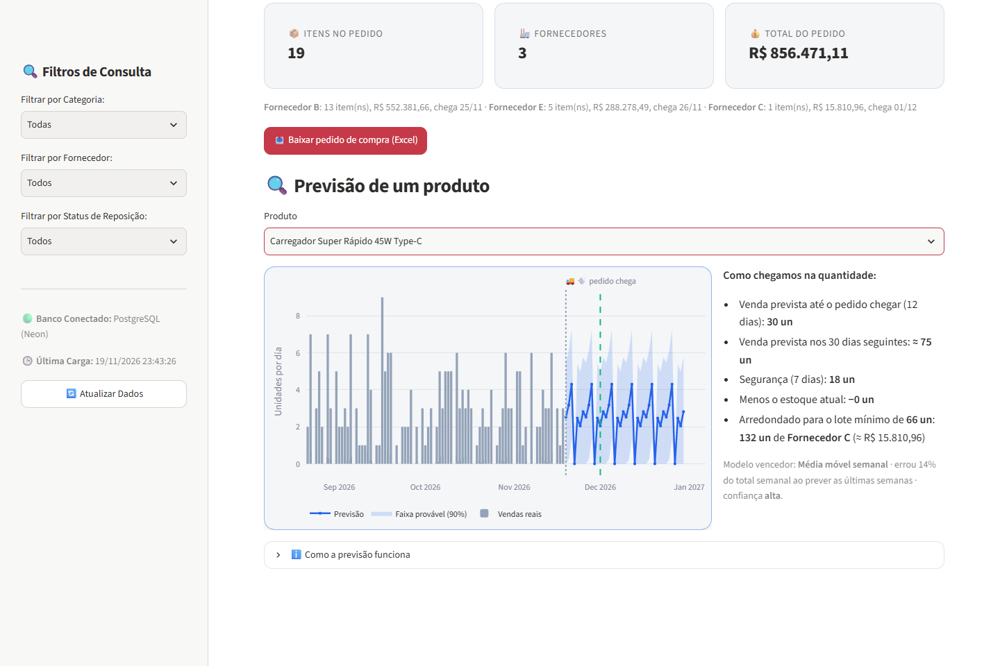
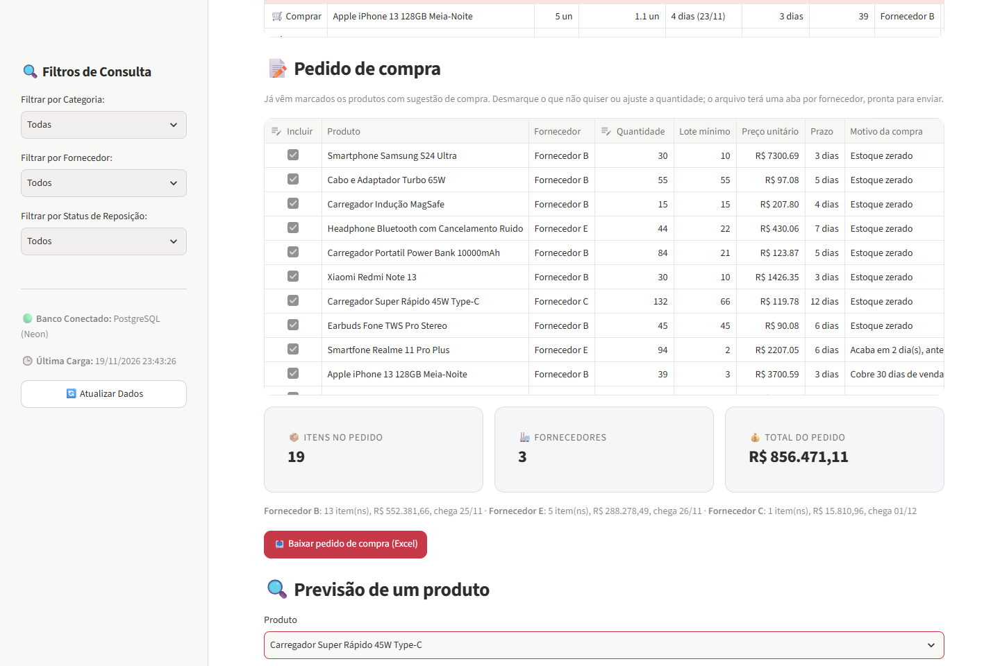

[← Voltar ao README](../README.md)

# 🔮 Previsão de Demanda e Pedido de Compra

A aba **📈 Previsão de Demanda** (`previsao_demanda.py`) usa o histórico de vendas para prever quando cada produto acaba, quanto comprar e de quem.

## Como a previsão é feita

1. **Calendário da loja detectado nos dados:** um dia da semana em que a loja quase nunca vende (menos de 25% dos dias com venda) é tratado como fechado, por exemplo o domingo. Dias atípicos sem nenhuma venda (feriados) também ficam fora do cálculo. Lojas online, que vendem todos os dias, são reconhecidas automaticamente.
2. **Competição de modelos por produto:** as últimas semanas do histórico (até 3) são escondidas e cada modelo tenta prevê-las. Vence o de menor erro no total semanal (WAPE):
   * **Holt-Winters (ETS)** com tendência amortecida e sazonalidade semanal (`statsmodels`);
   * **Croston (SBA)** para demanda intermitente (produtos que vendem em dias soltos), com o perfil de cada dia da semana;
   * **Média móvel semanal** ajustada pelo perfil de cada dia da semana;
   * **Ingênuo sazonal** (repete a última semana) como referência mínima, com penalidade para só vencer quando for claramente melhor.

   Produtos intermitentes (venda em menos da metade dos dias abertos) disputam só entre Croston e média móvel.
3. **Picos isolados** (promoções, compras atípicas) são limitados (Q3 + 3·IQR) para não inflarem a previsão.
4. **Confiança e incerteza:** cada produto mostra o modelo vencedor, o erro no teste e a confiança (alta até 20% de erro, média até 40%, baixa acima). O gráfico mostra uma faixa provável de 90%.

## Da previsão à compra

**Quantidade sugerida** = venda prevista até o pedido chegar + venda prevista no período de cobertura + estoque de segurança − estoque atual, arredondada para cima pelo **lote mínimo do fornecedor recomendado** (nunca um 🔴 Perigoso).

Produtos que vão acabar antes de um pedido feito hoje chegar ficam em vermelho na tabela e ganham o alerta **⏳ Ruptura prevista** na Visão Geral. A previsão também vai para o contexto do assistente de IA, que responde perguntas como "quando o iPhone 13 acaba?".

Parâmetros ajustáveis na tela: período que a compra deve cobrir (7 a 60 dias), dias de segurança, janela de histórico (30 a 90 dias) e prazo de reposição (automático pelo fornecedor ou digitado).

## 📝 Pedido de compra em Excel

O pedido (`pedido_compra.py` e `dashboard/pedido.py`) fecha o ciclo **analisar → decidir → agir**:

* Os produtos com sugestão de compra já vêm marcados numa tabela editável; o usuário desmarca o que não quer e ajusta as quantidades. Quantidades fora do lote mínimo geram aviso.
* O Excel tem uma aba **Resumo** (fornecedor, itens, unidades, total, maior prazo, chegada prevista e link para a aba) e **uma aba por fornecedor**, pronta para enviar, com código, produto, quantidade, lote mínimo, preço, subtotal, prazo, chegada prevista e motivo da compra (ex.: *"Acaba em 2 dia(s), antes do pedido chegar (6 dias)"*).
* Subtotais e totais são **fórmulas**: mudar uma quantidade no Excel atualiza os valores.
* O mesmo pedido pode ser baixado pela aba de Compras.

## Limites

Com poucos meses de vendas não dá para prever datas especiais do ano (Natal, Black Friday): para isso são precisos 1 a 2 anos de histórico. Vendas da loja física e online entram juntas na mesma série.
